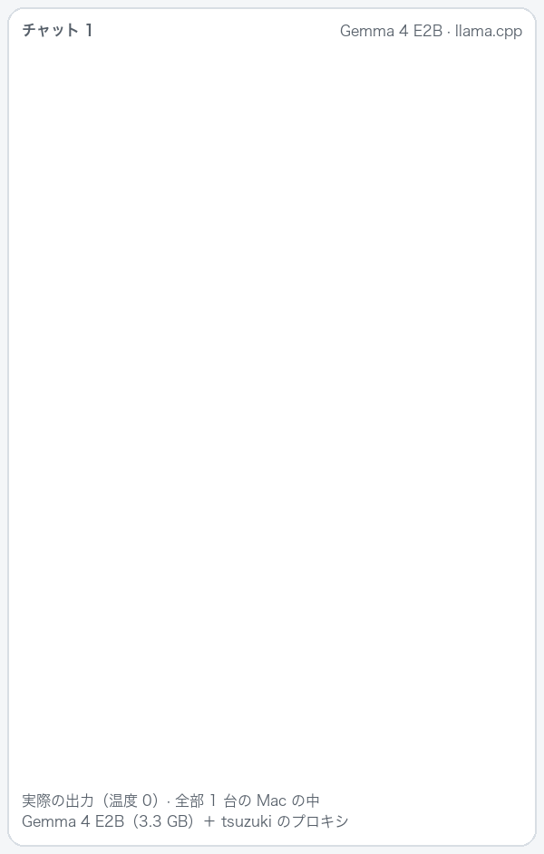
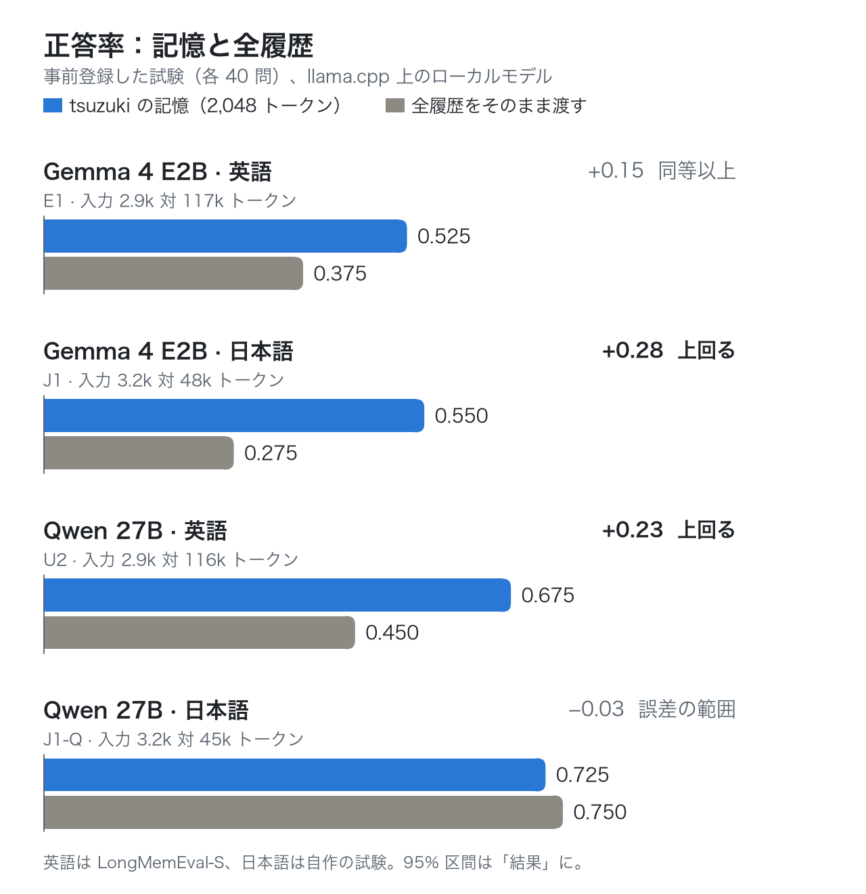

# tsuzuki：エージェントとチャットアプリのための、ローカルで動く長期記憶

**AI が前の会話を覚えている。しかも、何もマシンの外に出ない。**

[](https://github.com/inko9191/tsuzuki/actions/workflows/ci.yml) · Apache-2.0 · [English README](README.md)

<p align="center"></p>

- **チャットをまたいで覚える**：発言のたびに、前の会話から関係する部分を日付つきでモデルに渡す。最大 2,048 トークンで、全履歴ではない。似た発言が前に無ければ、何も渡さない。
- **全部手元で動く**：探すのは EmbeddingGemma 300m、過去の会話から事実を抜き出すのは小さいローカルモデル（Gemma 4 E2B）。クラウドのモデルを指定しない限り、どこにも送らない（MCP クライアントでクラウドのモデルを使うとき、たとえば Claude Desktop では、思い出した内容はそのモデルに渡る）。
- **今使っているものにつながる**：llama.cpp・Ollama・LM Studio を使い、OpenAI 互換の URL を設定できるチャットアプリ（Open WebUI など。ツールの呼び出しは要らない）、MCP クライアント（Claude Desktop、Claude Code、Cursor、LM Studio、Jan、Cline）、Hermes Agent、DeepSeek Harness、HTTP で何でも。
- **今までの履歴から始められる**：ChatGPT や Claude の書き出しを取り込めば、初日から前の会話を覚えている。
- **言う前に測った**：下の試験はすべて事前登録。答えを出す前に、判定のルールを書いて固定した。

<p align="center">
<picture>
  <source media="(prefers-color-scheme: dark)" srcset="docs/images/results-ja-dark.png">
  
</picture>
</p>

小さい Gemma 4 E2B では、記憶は全履歴と比べて、英語で同等以上、日本語で上回った。Qwen 27B では英語で上回り、日本語は誤差の範囲で同じ。どれも、モデルが読む量は全履歴の 1/14〜1/40。区間と限界は[結果](#結果事前登録)と[まだ示していないこと](#まだ示していないこと)。

**試す**（Node.js 22.19 以上と llama.cpp。[詳しくは下](#すぐに使うmacoslinuxwindows)）：

```bash
git clone https://github.com/inko9191/tsuzuki
cd tsuzuki
node scripts/setup.mjs
```

このリポジトリには、**EmbeddingGemma のモデルを動かす非公式の推論エンジン（Google とは無関係）**も入っている。Apple シリコン向けの C++/Metal 実装。

## すぐに使う（macOS、Linux、Windows）

**Node.js 22（22.19 以上）か 24 以上**、**llama.cpp**（の `llama-server`）、**git** が要る。Hermes Agent で使うときも、ほかには要らない（導入スクリプトは Hermes 自身の Python を使う）。

| | Node.js | llama.cpp | git |
|---|---|---|---|
| macOS | `brew install node` | `brew install llama.cpp` | Xcode のコマンドラインツールに入っている（`xcode-select --install`） |
| Windows | `winget install OpenJS.NodeJS.LTS` | `winget install llama.cpp`、または[リリース](https://github.com/ggml-org/llama.cpp/releases)のビルド | `winget install Git.Git` |
| Linux | [nodejs.org](https://nodejs.org)（ディストリビューションのパッケージは古いことが多い） | [リリース](https://github.com/ggml-org/llama.cpp/releases)のビルド、または `brew install llama.cpp` | パッケージマネージャー（`apt install git`） |

Windows では、`winget install` のあと新しいターミナルを開く。入れたプログラムは、新しいターミナルでしか `PATH` に入らない。

あとは：

```bash
git clone https://github.com/inko9191/tsuzuki
cd tsuzuki
node scripts/setup.mjs
```

スクリプトがすること：
1. どこで使うか（下の表）と、どこまで入れるかを聞く。**quick**（検索だけ：334 MB、5 分ほど）か **full**（事実あり：合計 3.7 GB、初回は 15〜30 分ほど。ほとんどがダウンロード）。
2. プラグインをビルドする。
3. モデルを確認してからダウンロードする。**EmbeddingGemma 300m**（334 MB、検索用。[Gemma の利用規約](https://ai.google.dev/gemma/terms)）と、full なら **Gemma 4 E2B**（3.35 GB、Apache 2.0。過去の会話から事実を抜き出す。会話が溜まっても思い出しが落ちにくくなる）。
4. 記憶を、使う場所につなぐ。
5. 使い捨ての記憶で、ある会話の発言が別の会話で思い出せること、事実が抜き出せることを確かめ、あなたのマシンで実際に見せる。新しいチャットが前のチャットの内容を答え、記憶なしの同じモデルと並べて表示する。

表示は英語か日本語（システムの言語。`--lang ja` でも指定できる）。失敗したときは、次に何をすればいいかを表示する。

| 使っているもの | 入力する言葉 | そこでの記憶の働き方 |
|---|---|---|
| 自分のモデルのサーバー（llama.cpp、Ollama、LM Studio など）を使うチャットアプリ | `chat` | モデルのサーバーの前に挟むプロキシ。アプリで、OpenAI 互換の URL を `http://127.0.0.1:8293/v1`、API キーをセットアップが表示するトークン（`~/.tsuzuki/config.json` の `token`）にする。Open WebUI では、管理者パネル → 設定 → 接続 で OpenAI API の接続を足す。チャットはすべて保存され、発言のたびに前のチャットから思い出す。ツールの呼び出しは要らない。検証したのと同じ形で、ツールをうまく呼べないことの多い小さいローカルモデルにはこれ。 |
| Claude Desktop、Claude Code、Cursor、LM Studio、Jan、Cline などの MCP クライアント | `mcp` | クライアントの MCP の設定に足すものを表示する（Claude Code なら `claude mcp add` のコマンド 1 行）。モデルにツール `recall`（思い出す）と `remember`（覚える）が渡り、いつ呼ぶかはモデルが決める（サーバーの説明で、いつ呼ぶかを伝えている）。`remember` が呼ばれない限り、何も保存されない。 |
| Hermes Agent | `hermes` | 発言のたびに関係する記憶が足され、会話はすべて保存される。セットアップの前に Hermes を終了する。あとは起動するものは無い。 |
| 自分で作るプログラム | `app` | 記憶のサーバーの HTTP API（[3d](#3d-そのほかhttp-サイドカー)）。 |

セットアップはこのどれかの言葉を聞く。`--for chat` などで先に答えておくこともできる（スクリプトの中など）。`chat` では、ログインするたびに記憶のサーバーを起動するかも聞く。

どの場合も、記憶は必要なときに llama.cpp を自分で起動し、次のために動かしたままにする（検索で約 0.5 GB、事実ありでさらに約 4 GB のメモリ）。全部止めるときは `node scripts/setup.mjs --stop`。事実は、会話が終わっておよそ 1 分後に裏で抜き出される。エージェントがクラウドのモデルを使っていても、事実の抜き出しは手元で行う。Hermes と MCP クライアントは会話の終わりを知らせるが、チャットアプリは知らせないので、プロキシでは 5 分発言が無ければ終わったとみなす（`proxy.segmentIdleMinutes`）。

**プロキシについて**
- サーバーの URL と API キーを設定できるアプリで使える：Open WebUI や、「OpenAI 互換」の設定があるアプリ。LM Studio と Ollama のアプリのチャット画面にはその設定が無く、llama-server に付いている Web ページは llama-server を直接呼ぶので、記憶は付かない（LM Studio は MCP クライアントとして使える：`--for mcp`）。
- 記憶のサーバーが動いている必要がある。セットアップが起動し、ログイン時に起動するかも聞く（`--autostart`）。そうしないときは、パソコンを再起動したあとに `node scripts/setup.mjs --start` で起動し直す。
- チャットは、前の発言（役割と本文）で見分ける。システムプロンプトは使わないので、日時の入ったプロンプトや、古い発言を削るアプリでも同じ会話のまま。発言のたびに送り直される履歴は 1 回だけ保存する。チャットの最初の発言は必ず新しい会話になるので、同じ言葉で始まる 2 つのチャットは混ざらない。思い出すときは、アプリが送ってきた発言だけを除く。
- 前の発言に似たものが無ければ、何も足さない：EmbeddingGemma 300m で類似度（コサイン）が 0.31 未満のとき（`recall.minSimilarity`。[M2](#m2記憶の要らない発言には何も足さない)）。記憶のサーバーのログ（`~/.tsuzuki/sidecar.log`）には、発言ごとに 1 行、前の発言をいくつ足したかと、いちばん似たものの類似度が残る。本文は残さない。
- 思い出した内容で、要求が最大 2,048 トークン増える。モデルのサーバーの文脈長に余裕を持たせる：Ollama の既定の文脈長は短いことがある（`OLLAMA_CONTEXT_LENGTH` を、たとえば 8192 にする）。llama-server は `-c`。
- アプリ自身の裏の作業（Open WebUI のタイトルやタグづけ。`### Task:` で始まる）と、ヘッダー `X-Memory: off` の付いた要求は、記憶なしでそのまま通す。`/v1/models` などほかの要求もそのまま通す。
- 思い出した内容は、システムプロンプトではなく最後のユーザーの発言の前に入れる。前の発言は変わらないので、モデルのサーバーのプロンプトキャッシュが効いたままになる。
- 転送先は、このマシンのモデルのサーバーだけ。記憶のサーバーと同じく、ウェブページからの要求は断る。ブラウザのページから直接モデルのサーバーを呼ぶアプリでは使えない。Docker Desktop のコンテナのアプリからは `http://host.docker.internal:8293/v1`（未確認）。Linux では、コンテナを `--network=host` で動かして `127.0.0.1` を使う。

モデルは `~/.tsuzuki/models`、記憶のサーバーのデータは `~/.tsuzuki/memory`（Hermes は `<プロファイル>/tsuzuki`）。`node scripts/setup.mjs --help` で選択肢（`--for chat|mcp|hermes|app`、`--quick`、`--upstream`、`--models`、`--llama-server`、`--report`、`--lang`、`--yes`、`--start`、`--stop`、`--autostart`、`--update`、`--version` など）が出る。何度実行してもよく、途中で止まったダウンロードは続きから再開する。

### ターミナルから記憶を見る

`node scripts/memory.mjs` で、記憶が覚えていることを見たり変えたりできる。記憶のサーバーが止まっていれば起動する。`--config <パス>` で別の記憶（Hermes のプロファイルの `<プロファイル>/tsuzuki/config.json` など）を指定できる。

| コマンド | すること |
|---|---|
| `status` | 記憶のサーバーが動いているか、発言と事実をいくつ覚えているか |
| `recent [N]` | 最近の会話 N 件、新しい順。会話の ID つき |
| `show <ID>` | 1 つの会話の発言 |
| `search <言葉>` | その言葉でモデルに渡される、日付つきの記憶 |
| `forget <ID>`、`forget --before 2026-01-01`、`forget --all` | 確認してから消す（`--yes` で確認なし） |
| `export [ファイル]` | 全部の発言を JSON Lines で書き出す（バックアップ） |
| `import <ファイル>` | ChatGPT や Claude の履歴を取り込む（下） |

**ChatGPT や Claude の履歴から始める。** サービスに書き出しを頼み（ChatGPT：設定 → データ コントロール → データをエクスポートする。Claude：設定 → プライバシー → データをエクスポート。画面の言葉は版によって少し違う）、メールで届く zip をダウンロードして、そのまま渡す：

```bash
node scripts/memory.mjs import ~/Downloads/書き出し.zip
```

- 会話は 1 つずつ、元の日付のまま保存する。ChatGPT は最後に表示していた枝を取る（前の編集や生成し直す前の返事は取らない）。非表示の発言、ツールの呼び出しとその出力は入れない。画像やファイルは取り込まない。
- このマシンから出ない。保存する前に秘密を伏せ字にするのも、ふだんの発言と同じ。同じ書き出しをもう一度取り込んでも、二重には保存しない。
- 発言の索引ができれば、すぐに思い出せる（残りは `status` で分かる）。M5 Max では、会話 200 件・発言 4,000 件の保存に 2 秒、索引に 70 秒ほどだった。事実は裏で 1 件ずつ抜き出す。速い Mac の Gemma 4 E2B で 1 件 4 秒ほどなので、会話 1,000 件で 1 時間ほど。GPU がないともっとかかる。

### 動かし続ける、新しくする

- `node scripts/setup.mjs --autostart` で、ログインしたときに記憶のサーバーが起動する（macOS は LaunchAgent、Linux は systemd のユーザーサービス、Windows はスタートアップのフォルダ）。`--autostart=off` でやめる。
- `node scripts/setup.mjs --update` で、最新版を取得（`git pull`）し、ビルドして、記憶のサーバーを再起動し、変更点を表示する（[CHANGELOG](CHANGELOG.md)）。設定と記憶はそのまま。Hermes や MCP クライアントは、そのあと再起動する。
- `--start` と `--stop` は、手で起動したり止めたりする。

### 取り除く

1. `node scripts/setup.mjs --autostart=off` のあと `node scripts/setup.mjs --stop`（記憶のサーバーと、それが起動した llama.cpp のサーバーを止める）。
2. つなぎを外す：MCP クライアントの設定から `tsuzuki` を消す、チャットアプリの URL をモデルのサーバーに戻す、Hermes なら、セットアップが横に作った `config.yaml` のバックアップに戻し（または `memory.provider: tsuzuki` を消し）、`<プロファイル>/plugins/tsuzuki` を消す。
3. `~/.tsuzuki`（モデルと記憶。Hermes は `<プロファイル>/tsuzuki`）と、このフォルダを消す。

### 自分のマシンで試して報告する

`node scripts/setup.mjs --report` は、セットアップのあとに短い報告を表示する。OS、CPU、メモリ、GPU、llama.cpp の版と使える機器、各段階にかかった時間。失敗したときも、エラーと一緒に表示する。ホームフォルダとユーザー名は取り除く。[動作報告](https://github.com/inko9191/tsuzuki/issues/new?template=test-report.yml)に貼ってほしい。試すだけなら `--report --quick`（334 MB、5 分ほど）で足りる。

DeepSeek Harness、自分で立てたモデルのサーバー、Ollama、このリポジトリの Mac 用エンジンを使うときは、[入れ方（手動）](#入れ方手動)。[CI](.github/workflows/ci.yml) で、Linux・Windows・macOS それぞれ、この手順を最後まで動かしている（GitHub の仮想マシン、llama.cpp の公式の CPU 版。ある会話の発言が別の会話で思い出されることの確認まで）。事実の抽出まで確かめているのは Linux だけで、Hermes につなぐ手順（`--for hermes`）は Mac でしか動かしていない。Windows では、ファイルの権限はユーザーのフォルダのもの。

## 中身

| 部品 | 場所 | すること |
|---|---|---|
| 記憶 | `dsh-plugins/packages/tsuzuki`（npm の名前は `dsh-tsuzuki`） | 発言の保存、事実の抽出、検索、記憶のブロックづくり。dsh のプラグインとサイドカー（コマンド `tsuzuki-memory`）は同じコード。 |
| 埋め込みエンジン | `native/`、`server/`、`reference/` | EmbeddingGemma（300m と 2）を C++/Metal で動かし、OpenAI 互換の `/v1/embeddings` のデーモン（`egemma-server`）で提供する。**Apple シリコン専用。** |
| dsh の埋め込みプロバイダ | `dsh-plugins/packages/text-embeddings*` | dsh の `ctx.textEmbeddings`。`dsh-text-embeddings-tsuzuki` はこのエンジンを、`dsh-text-embeddings-openai` は Ollama などの OpenAI 互換の接続先を使う。 |
| Hermes のプロバイダ | `integrations/hermes/` | サイドカーと話す Hermes Agent の `MemoryProvider`（id は `tsuzuki`）。 |
| セットアップとターミナル | `scripts/setup.mjs`、`scripts/memory.mjs` | 1 コマンドのセットアップと、ターミナルからの記憶の操作（ChatGPT や Claude の取り込みも）。 |
| 評価 | `docs/MEMORY_*`、`scripts/eval/`、`results/eval/memory/` | 事前登録、スクリプト、集計した結果。 |

### 記憶のしくみ

1. **保存**：ユーザーとアシスタントの発言を SQLite のファイルに入れる。サブエージェントのセッションは入れない。先に秘密情報を伏せ字にする（「プライバシー」）。
2. **索引**：発言を、1つ前の発言と組にして埋め込む。
3. **事実**：セッションを、約 2,500 トークンか、30 分発言のない所（チャットのプロキシでは 5 分）か、ホストがセッションの終わりを知らせた所で区切る。区切りごとに、手元のチャットモデルが裏で次を行う。
   - その区切りに書かれた事実を挙げる。事実には、もとになった発言を付ける。
   - 更新のリンクを付ける（新しい事実が古い事実を置き換える、という印）。

   事実も検索するが、返すのは、事実が指す**元の発言**だけ。裏の作業は、エージェントか llama.cpp のサーバーが忙しい間は待つ。
4. **想起**：新しいユーザー発言の前に、
   - その発言を埋め込む。
   - 発言の窓と事実を順位付けし、RRF でまとめる。
   - ほかのセッションの窓と事実のどれも、発言との類似度（コサイン）が 0.31 に届かなければ、何も足さない（M2 の門。EmbeddingGemma 300m のときだけ。`recall.minSimilarity`）。
   - 届けば、*ほかの*セッションの発言から、良いものを 2,048 トークンまで選ぶ。

   日付の順に並べ、今日の日付と「いちばん新しい発言が今の事実」という規則を添えて渡す。既定では並べ替え（rerank）はしない。発言の本文は `<memory>` のブロックを閉じたり開いたりできず、2 行目からは字下げされるので、保存された発言が指示やほかの抜粋のふりをすることはできない（評価のときは、複数行の発言を字下げせずに渡していた）。
5. **ツール**：`memory_search`（Hermes では `tsuzuki_search`）は、今のセッションも含めて全セッションを検索する（並べ替えは、オンにしない限りしない）。`memory_forget`（Hermes では `tsuzuki_forget`）は記憶を消す。**既定でオフ**（「プライバシー」）。

## 結果（事前登録）

判定の規則は、回答を1つも作る前に文書で固定した。下の数字は `results/eval/memory/` の報告ファイルから写した。

プラグインの既定値は、評価した設定 **P**。探索の回（U1、30 問）で決め、U2 で、まだ使っていない問題で確かめた。

**まとめ**
- **小さいローカルモデル**（Gemma 4 E2B）では、記憶は全履歴を文脈に入れるのと比べて、英語で同等以上（+0.150、E1）、日本語で上回る（+0.275、J1）。
- **大きいローカルモデル**（Qwen 27B）では、英語で同じ書式の全履歴（約 11.6 万トークン）より +0.225（U2-AT、上回る）。約 4.5 万トークンの日本語の履歴では、入力 1/14・約 17 倍速で、正確さは誤差の範囲で同じ（J1-Q、判定不能）。
- **保存したセッションが数千になると**精度は落ちる。事実（ローカルのチャットモデルを設定すれば既定でオン）で一部を取り戻せる。枠を広げることと、小さいモデルによる並べ替えでは戻らない（S2、S3）。
- **記憶の要らない発言**（M2）：類似度の門で、Gemma 4 E2B の断り（「記憶にない」）が 8.3% から 1.8% に、害のある返事全体が 14.9% から 6.4% に減った。記憶の要る質問の正答率は変わらない（−0.7 ポイント、区間 −2.2〜0.0）。0.2.1 から既定でオン。

**条件**
- **データ**：[LongMemEval](https://github.com/xiaowu0162/LongMemEval)-S（cleaned 版）。新しい 40 問を、ID と種類だけを見て、固定の seed で選んだ（knowledge-update 10、temporal-reasoning 10、multi-session 10、single-session 6、abstention 4）。履歴は合計 1,862 セッション。問題の ID は `results/eval/memory/longmemeval-u2-plan.json`。
- **モデル**：Qwen3.8-27B Q4_K_M（GGUF）、llama.cpp の `llama-server`（b10964）、thinking なし。同じモデルが、回答、事実の抽出と更新の判定、主判定（LongMemEval の種類別の採点プロンプト）を行った。
- **埋め込み**：EmbeddingGemma 300m、fp32、このリポジトリの Metal エンジン。
- **機械**：Apple M5 Max・メモリ 64 GB の Mac 1 台。U2 と E1 のファイルには、モデルのハッシュ、llama.cpp の版、サーバーの引数を記録した。
- **統計**：質問単位の対応ありパーセンタイル・ブートストラップ（10,000 回、seed 0）。

### U2：記憶と全履歴（Qwen 27B）

| 設定 | モデルに渡すもの | 正答率 | 棄権率 | 入力トークン（平均） | 回答時間（平均） |
|---|---|---:|---:|---:|---:|
| **P**（tsuzuki の既定） | 直近の履歴 ＋ 日付つきの記憶 2,048 トークン | **0.675** | 0.250 | **2,913** | **5.7 秒** |
| C512（前に固定した版） | 直近の履歴 ＋ 記憶 512 トークン、rerank あり | 0.475 | 0.525 | 1,218 | 3.0 秒 |
| A：全履歴 | 全セッションを窓 131,072 トークンに入れる。前に固定した書式（質問の日付なし） | 0.325 | 0.675 | 116,166 | 426.7 秒 |
| AT：全履歴、P と同じ書式（U2-AT） | 全セッションを日付順に、質問の日付と P の規則つきで | 0.450 | 0.425 | 116,289 | 431.2 秒 |

40 問すべてが全履歴の窓に入った。

| 事前登録した比較 | 点差 | 95% 区間 | 判定 | 勝 / 負 / 同 |
|---|---:|---|---|---|
| P − C512 | +0.200 | [+0.075, +0.350] | 改善 | 9 / 1 / 30 |
| P − A | +0.350 | [+0.200, +0.500] | 上回る | 14 / 0 / 26 |
| P − AT（追試 U2-AT） | +0.225 | [+0.100, +0.350] | 上回る | 9 / 0 / 31 |

つまり、この 40 問とこのローカルモデルでは、2,048 トークンの記憶のほうが、約 11.6 万トークンの全履歴を文脈に入れるより多く正解した。入力は約 40 分の 1、1 回答の時間は約 75 分の 1。全履歴も P と同じ日付つきの書式にすると良くなった（AT − A：+0.125 [+0.025, +0.225]、傾向参考）が、P には届かなかった。

**副次の採点（Claude）**：Claude が、設定の名前を伏せたシートで U2 の回答を採点した（Claude は実験の設計者でもあるので、名前を伏せた）。
- 正答率：P 0.725、C512 0.475、A 0.350。Qwen との一致率 0.960、Cohen の κ 0.918。
- P − C512：+0.250 [+0.100, +0.400]。P − A：+0.375 [+0.225, +0.525]。

AT の回答は Claude が単独で採点したので、設定は伏せられなかった。AT 0.525。P − AT：+0.200 [+0.050, +0.350]（上回る）。Qwen との一致率 0.925、κ 0.85。

**種類別**（Qwen の採点。1 種類 4〜10 問なので傾向のみ）

| 設定 | knowledge-update | multi-session | single-session | temporal-reasoning | abstention |
|---|---:|---:|---:|---:|---:|
| P | 0.80 | 0.70 | 0.50 | 0.50 | 1.00 |
| C512 | 0.60 | 0.40 | 0.50 | 0.20 | 1.00 |
| A | 0.50 | 0.10 | 0.50 | 0.00 | 1.00 |
| AT | 0.70 | 0.40 | 0.50 | 0.00 | 1.00 |

### E1：小さいモデル（Gemma 4 E2B）が答える場合

同じ 40 問（[`docs/MEMORY_LONGMEMEVAL_E1_PREREG.md`](docs/MEMORY_LONGMEMEVAL_E1_PREREG.md)）。答える役を Gemma 4 E2B（Google 公式の QAT q4_0 の GGUF、窓 131,072 トークン）に替えた。**E2B-P には、U2 で Qwen の P が受け取ったのとまったく同じメッセージを渡した**。記憶そのものは Qwen 27B のパイプラインで作ったもので、替えたのは答える役だけ。E2B-AT は 40 問すべてが窓に入った。主判定は Qwen。

| 設定 | 正答率 | 棄権率 | 入力トークン | 回答時間 |
|---|---:|---:|---:|---:|
| E2B-P（Gemma 4 E2B ＋ 記憶） | **0.525** | 0.025 | 2,942 | 1.0 秒 |
| E2B-AT（Gemma 4 E2B ＋ 全履歴、同じ書式） | 0.375 | 0.075 | 117,101 | 98.3 秒 |
| 参考：Qwen 27B の P（U2） | 0.675 | | | |
| 参考：Qwen 27B の AT（U2-AT） | 0.450 | | | |

- **製品の目安**（E2B-P ≥ 0.50）：**満たす**。
- **主：E2B-P − Qwen-AT**（小さいモデル＋記憶 対 大きいモデル＋全履歴）：+0.075 [−0.100, +0.250]、**判定不能**、8 / 5 / 27。
- E2B-P − E2B-AT：+0.150 [−0.025, +0.300]、同等以上（非劣性）、9 / 3 / 28。
- E2B-P − Qwen-P：−0.150 [−0.325, +0.000]、傾向参考（答える役を小さくした分の損）。
- 副次の採点（Claude、名前を伏せ、Qwen の採点を開く前）：E2B-P 0.650、E2B-AT 0.475、Qwen-AT 0.525。E2B-P − Qwen-AT は +0.125 [−0.025, +0.275]、E2B-P − E2B-AT は +0.175 [+0.000, +0.350] で、どちらも同等以上（非劣性）。Qwen との一致率 0.887、κ 0.78。主判定は Qwen の採点のまま、判定不能。

### J1：日本語、全部 Gemma 4 E2B

自作の日本語テスト（[`docs/MEMORY_JA_J1_PREREG.md`](docs/MEMORY_JA_J1_PREREG.md)）。公開されている日本語の長期記憶のテストが見つからなかったので、答えの入った会話と紛らわしい会話を書いて 40 問を作り（正解は作った時点で決まっている）、1 問あたり約 47 本の一般的な日本語の雑談（約 4.8 万トークン）に混ぜた。**小さいマシンで動く部分は全部 Gemma 4 E2B**（事実の抜き出し、更新リンク、回答）。採点だけ Qwen 27B。

| 条件 | 正答率 | 入力トークン | 回答時間 |
|---|---:|---:|---:|
| E2B-P（記憶、全部 E2B） | **0.550** | 3,190 | 0.9 秒 |
| E2B-AT（全履歴、同じ書式） | 0.275 | 47,689 | 20.2 秒 |

- **主：E2B-P − E2B-AT**：+0.275 [+0.150, +0.425]、**上回る**（11 勝 / 0 敗 / 29 同）。製品の目安を満たす。
- 記憶は 40 問すべてで答えの会話を含んでいた（1.00）。日本語でも検索は崩れず、外したのは読み取りと推論（日付の計算 0.12、複数の会話の数え上げ 0.25）。
- 副次の採点者（Claude、条件名を伏せて）：0.700 対 0.425、+0.275 [+0.125, +0.425]、上回る。一致 0.850、κ 0.71。
- 自作のテストは本物の会話より整っている。方法が日本語にも通じるかの確認として読むこと（ベンチマークの点数ではない）。

### J1-Q：同じ日本語のテストを、全部 Qwen 27B で

J1 の規則で行うことになった追試（[`docs/MEMORY_JA_J1Q_PREREG.md`](docs/MEMORY_JA_J1Q_PREREG.md)、実行記録 [`docs/MEMORY_JA_J1Q_RUNLOG.md`](docs/MEMORY_JA_J1Q_RUNLOG.md)）。記憶づくりも答える役も Qwen3.8 27B。

| 条件 | 正答率 | 入力トークン | 回答時間 |
|---|---:|---:|---:|
| Qwen-P（記憶） | 0.725 | 3,205 | 5.8 秒 |
| Qwen-AT（全履歴、同じ書式） | 0.750 | 45,311 | 99.4 秒 |

- **主：Qwen-P − Qwen-AT**：−0.025 [−0.100, +0.050]、**判定不能**（1 勝 / 2 敗 / 37 同）。
- 大きいモデルは、約 4.5 万トークンの日本語の履歴を、記憶と同じくらいよく読める。ここでの記憶の利点は正確さではなく費用（入力 1/14、約 17 倍速）。小さいモデル（J1）では、記憶の方がはっきり正確だった。
- 副次の採点者（Claude、条件名を伏せて）：0.825 対 0.850、−0.025 [−0.100, +0.050]、判定不能。一致 0.900、κ 0.71。

### S2 と S3：保存したセッション 5,000、答える役は Gemma 4 E2B

規模試験（下）では、関係のない履歴が増えるほど想起が落ちた。S2 と S3 は、保存したセッション 5,000（約 5.2 万発言）での**回答**を、Gemma 4 E2B が答える形で測った。問題は、まだ使っていない LongMemEval-S の 60 問（棄権を除く種類ごとに 10）。答えの会話は元の日付のまま、詰め物の会話の間に入れた（[`docs/MEMORY_SCALE_S2_PREREG.md`](docs/MEMORY_SCALE_S2_PREREG.md)、[`docs/MEMORY_SCALE_S3_PREREG.md`](docs/MEMORY_SCALE_S3_PREREG.md)、実行記録 [`docs/MEMORY_SCALE_S3_RUNLOG.md`](docs/MEMORY_SCALE_S3_RUNLOG.md)）。

| 5,000 セッションでの想起 | 正答率 | 想起に答えの発言 | 窓だけとの差 |
|---|---:|---:|---|
| 発言の窓だけ（チャットモデルなしの dsh の想起） | 0.317 | 0.483 | |
| 枠 8,192 | 0.267 | 0.733 | −0.050 [−0.133, +0.033]、判定不能 |
| E2B が上位 30 窓を並べ替える（製品のオプション） | 0.267 | 0.417 | −0.050 [−0.133, +0.017]、判定不能 |
| E2B が上位 100 窓を並べ替える | 0.250 | 0.350 | −0.067 [−0.133, −0.017]、**悪化** |
| 質問の言葉から日付で絞る | 0.317 | 0.483 | ±0（効いたのは 60 問中 4 問） |
| **事実あり：設定 P（S3）** | **0.400** | 0.667 | +0.083 [−0.017, +0.183]、判定不能、7 勝 / 2 敗 |
| 参考：窓だけ、50 セッション | 0.433 | 0.850 | |

- 小さいモデルには、量を増やしても効かない。枠 8,192 では答えが E2B の目の前に来ることは増えたが、答えは悪くなった。並べ替え役としての E2B は、密な検索の順より悪い候補を選んだ。そのため**並べ替えは既定でオフ**（`memory_search` も）。
- 事実（設定 P。事実の抜き出しと更新の判定も E2B 自身）は、どの比較でも同じ向きだった。ここで +0.083、別の 60 問で +0.050、50 セッションで +0.067（合わせて 19 勝 7 敗）。ただし、どの区間も 0 をまたぐ。5,000 セッションでの P（0.400）は、50 セッションでの窓だけ（0.433）に近い。
- 5,000 セッション分の事実づくりは、M5 Max の E2B で約 3.7 時間（7,074 区間、8 件ずつ同時に）。ふだんの利用では、会話のあとに裏で 1 件ずつ行い、1 会話あたり中央値 4.2 秒、遅いほうから 1 割で 7.9 秒（LongMemEval-S の約 2,200 トークンの会話 60 件。[`results/eval/memory/write-cost-report.md`](results/eval/memory/write-cost-report.md)）。以前の README には約 10〜14 秒と書いていたが、それは 8 件で GPU を分け合ったときの 1 件の時間だった。
- 副次の採点者（Claude、条件名を伏せた 90 件の抜き取り）：一致 0.978（κ 0.95、S2）、0.944（κ 0.89、S3）。

### M2：記憶の要らない発言には何も足さない

たいていの発言に記憶は要らないが、想起は関係が無くても、いちばん近い部分を必ず足していた。すると Gemma 4 E2B は、普通の頼みを断ったり（「記憶にない」）、関係のない前の話題を答えに持ち込んだりした。M2（[`docs/MEMORY_MISFIRE_M2_PREREG.md`](docs/MEMORY_MISFIRE_M2_PREREG.md)、結果は [`docs/MEMORY_MISFIRE_M2_RESULTS.md`](docs/MEMORY_MISFIRE_M2_RESULTS.md)）では門を試した。いちばん似た前の発言との類似度（コサイン）が τ\* = 0.31 未満なら、何も足さない。τ\* は、テストの前に別の利用者で決めてある。テストは新しい 136 人：英語の LongMemEval-S の履歴を持つ 96 人と、新しく作った日本語のセット（J2）の 40 人。記憶の要らない発言が 1,088 件、記憶の要る質問が 136 問。答えたのは Gemma 4 E2B で、発言の窓だけ（quick）。

| | 断り | 害のある返事（断りか、関係のない記憶の持ち込み） | 質問の正答率 |
|---|---:|---:|---:|
| 記憶なし | 0.1% | 0.4% | 8.1% |
| 門なしの記憶（0.2.0） | 8.3% | 14.9% | 52.2% |
| **門ありの記憶（0.2.1）** | **1.8%** | **6.4%** | **51.5%** |

- 事前登録の 2 つのルールはどちらも成立：断り −6.4 ポイント（区間 −8.0〜−5.0）、正答率 −0.7（区間 −2.2〜0.0。下限が −5 ポイント以上）。
- 門を入れても、質問の 96%、ほかの発言の 68% には記憶を足した。答えを落とした質問は 1 問。
- 日本語ではほとんど変わらなかった。日本語の発言は履歴と話題が重なっていて 80% が門を通り、もともと害も少なかった。残った害（6.4%）はほとんど英語で、前の話題を関係のない質問に持ち込む、前の返事の書き方をまねる、など。
- 二人目の採点（Claude、条件を伏せて）：Qwen の採点との κ は 0.69。
- 0.31 は EmbeddingGemma 300m での値なので、ほかの埋め込みモデルでは、設定しない限り門は使わない。事実（full）はテストに入っていない。

全部の表（V1024R・T2048 の比較つき）：
- [`results/eval/memory/longmemeval-u2-report.md`](results/eval/memory/longmemeval-u2-report.md)、[`longmemeval-u2-at-report.md`](results/eval/memory/longmemeval-u2-at-report.md)、[`longmemeval-e1-report.md`](results/eval/memory/longmemeval-e1-report.md)、[`j1-report.md`](results/eval/memory/j1-report.md)、[`j1q-report.md`](results/eval/memory/j1q-report.md)、[`s2-report.md`](results/eval/memory/s2-report.md)、[`s3-report.md`](results/eval/memory/s3-report.md)、[`m2-report.json`](results/eval/memory/m2-report.json)。探索：[`scale-diagnosis.md`](results/eval/memory/scale-diagnosis.md)、[`scr1-report.md`](results/eval/memory/scr1-report.md)
- [`longmemeval-u2-claude-judge.md`](results/eval/memory/longmemeval-u2-claude-judge.md)、[`longmemeval-u2-at-claude-judge.md`](results/eval/memory/longmemeval-u2-at-claude-judge.md)、[`longmemeval-e1-claude-judge.md`](results/eval/memory/longmemeval-e1-claude-judge.md)、[`j1-claude-judge.md`](results/eval/memory/j1-claude-judge.md)、[`j1q-claude-judge.md`](results/eval/memory/j1q-claude-judge.md)、[`s2-claude-judge.md`](results/eval/memory/s2-claude-judge.md)、[`s3-claude-judge.md`](results/eval/memory/s3-claude-judge.md)
- 事前登録：[`docs/MEMORY_LONGMEMEVAL_U2_PREREG.md`](docs/MEMORY_LONGMEMEVAL_U2_PREREG.md)、[`docs/MEMORY_LONGMEMEVAL_U2_AT_PREREG.md`](docs/MEMORY_LONGMEMEVAL_U2_AT_PREREG.md)、[`docs/MEMORY_LONGMEMEVAL_E1_PREREG.md`](docs/MEMORY_LONGMEMEVAL_E1_PREREG.md)、[`docs/MEMORY_MISFIRE_M2_PREREG.md`](docs/MEMORY_MISFIRE_M2_PREREG.md)

### 事前登録について

この公開リポジトリは、新しいスナップショット（最初のコミット）から始まる。その後のコミットは [`docs/SANITIZED.md`](docs/SANITIZED.md) に記録している。事前登録は、作者の非公開の開発リポジトリで、結果より**前に**コミットした。その履歴はここには入っていないので、ここでは順番を示せない。ここで確かめられること：`results/eval/memory/` の各 `*-plan.json` に、事前登録の文書と、実行したコードの sha256 が記録されている。これらのファイルは非公開のリポジトリとバイト単位で同じ。例外は、[`docs/SANITIZED.md`](docs/SANITIZED.md) に元と今の両方のハッシュを並べた数ファイルだけ。元のコミット履歴は、求められれば見せる。

## まだ示していないこと

- **コーディングと作業中の記憶**：`working.enabled` は、ツールの呼び出しと結果を保存し、dsh が文脈を要約したあとで、要約から落ちた細部を戻す。**実験的で、既定はオフ**。事前登録した試験 C1（[`docs/MEMORY_CODING_C1_PREREG.md`](docs/MEMORY_CODING_C1_PREREG.md)）は、**判定を出さずに打ち切った**。dsh 自身の要約が、ローカルの Qwen 27B と 32k の窓では安定せず、記憶ではなく要約を測ることになるため。
- **自作テスト以外の日本語**：J1 と J1-Q（上）は小さな自作テストで、本物の日本語の利用者の会話は測っていない。
- **数千セッション**：取り出しだけの規模試験（[`results/eval/memory/scale-report.md`](results/eval/memory/scale-report.md)。LongMemEval-S のセッション、発言の窓だけ、事実なし、rerank なし）で、60 問のうち答えの発言が想起に入った割合は、保存したセッションが 50 で 0.883、500 で 0.717、2,000 で 0.667、5,000 で 0.517 だった（5,000 − 50：−0.367 [−0.483, −0.250]）。**関係のない履歴が増えるほど精度は落ちる。** S2 と S3（上）で 5,000 セッションでの回答を測った。事実で一部を取り戻せ、枠の拡大と小さいモデルの並べ替えでは戻らなかった。5,000 セッションより先は測っていない。
- **本当の長期利用**：試験はベンチマークの履歴で、何か月分もの本物の会話ではない。
- **ほかのハードウェアと Mac 以外の経路**：すべて Mac 1 台で測った。llama.cpp の埋め込みの経路（EmbeddingGemma 300m、Q8_0 の GGUF）は、その Mac で fp32 のエンジンと比べた（[`scripts/eval/scale/llamacpp_parity.mjs`](scripts/eval/scale/llamacpp_parity.mjs)）。発言の窓 200 と質問 60 で cos ≥ 0.9997、上位 10 件の重なり 0.992、規模試験の想起は 500 セッションで同じ（0.717 と 0.717）、5,000 セッションでも同じ（0.517 と 0.517）。Linux と Windows では CI（GitHub の仮想マシン、CPU 版）でしか動かしていない。最後まで動くことは確かめたが、想起の質はそこでは**測っていない**。Ollama の経路は**測っていない**。Ollama の EmbeddingGemma 300m は、fp32 のエンジンと数値が違う可能性がある。EmbeddingGemma 2 は設定 P で測っていない（LoCoMo の探索では、取り出しが 300m より recall@10 で 0.03 低かった）。
- **ほかのモデル**：U2 では、回答・事実の抽出・採点がすべて同じローカルの Qwen3.8-27B Q4_K_M。E1 は答える役だけを替えた。長い文脈に強いクラウドのモデルは試していない。そうしたモデルなら、全履歴との差は縮むか、逆になるかもしれない。
- **取り込んだ履歴**：ChatGPT と Claude の書き出しの取り込みは、両方の形式の書き出しのテストで動くことを確かめた。ただし、話題も年もさまざまな実際の履歴を取り込んだときの思い出しの質は測っていない。
- **プロキシと MCP クライアント**：プロキシは検証した思い出し方（発言の窓と事実、2,048 トークン、ユーザーの発言の前）を使うが、入れる先は評価のときの書式ではなく、アプリが送る会話。答えへの効果は測っていない。MCP クライアントでは、いつ思い出し、何を覚えるかをモデルが決める。これも測っていない。動くことは確かめた。Gemma 4 E2B の前にプロキシを挟むと、新しいチャットで前のチャットの内容を答えた（英語と日本語）。MCP サーバーは公式の MCP の Python SDK で確かめた。上に挙げたアプリそれぞれでは試していない。
- **保存のときのコスト**：回答時間には、保存のときの裏の作業（チャットモデルによる事実の抽出と更新の判定、埋め込み。M5 Max の Gemma 4 E2B で 1 件ずつなら 1 会話あたり中央値 4.2 秒）を含めていない。全履歴の時間は、llama.cpp のホストのプロンプトキャッシュを切って測った。
- **公表されている LongMemEval の点との比較**：比べられない。公表値は GPT-4o の採点と別のモデルを使っている。
- **M2 の外での門**：門の 0.31 は、EmbeddingGemma 300m で、発言の窓だけ、会話の最初の発言で測った。事実あり（full）、ほかの埋め込みモデル、チャットの 2 つ目以降の発言では測っていない。
- **精度**：40 問なので区間が広い。U2 の主判定は、答えたのと同じモデル。副次の採点はそれを確かめるためのもの。

## 必要なもの（手で入れるとき）

[すぐに使う](#すぐに使うmacoslinuxwindows)には Node.js、llama.cpp、git だけでよい。手で入れるときは次のとおり。

- **Node.js** `^22.19` か `>=24`。dsh とサイドカーは `node:sqlite` を使う。
- **事実の抽出に使うチャットの接続先**：OpenAI 互換で、JSON スキーマの出力ができるもの。検証したのは llama.cpp の `llama-server` と Qwen3.8-27B Q4_K_M。無くても発言の窓だけで動くが、それは評価した設定 P **ではない**。
- **埋め込み**：次のどちらか。
  - **Apple シリコンの Mac**（評価した経路）：このリポジトリのエンジンで EmbeddingGemma 300m を fp32 で動かす。Xcode、CMake、Python 3.13、[uv](https://github.com/astral-sh/uv) が要る。
  - **ほかのマシン**：llama.cpp の `llama-server` と EmbeddingGemma 300m の GGUF（エンジンと比べて確認済み）、または [Ollama](https://ollama.com) の `embeddinggemma`（測っていない）。
- **Hermes Agent で使うとき**：Hermes に同梱の Node（`~/.hermes/node/bin/node`）か、上の条件を満たす Node。

## 入れ方（手動）

### 1. プラグインをビルドする（どの使い方でも）

```bash
cd dsh-plugins
npx -y pnpm@10.26.1 install --frozen-lockfile
npx -y pnpm@10.26.1 run build
npx -y pnpm@10.26.1 -r --filter './packages/*' pack --pack-destination dist
```

dsh 用のパッケージが `dsh-plugins/dist/*.tgz` に、サイドカーが `dsh-plugins/packages/tsuzuki/lib/server.js` にできる。パッケージは npm に公開していない。tarball は必ず**絶対パス**で入れる。パッケージ名で入れてはいけない（npm に同じ名前のパッケージがあれば、そちらが入る）。

### 2. 埋め込み

**Mac（評価した経路）**：リポジトリのルートで実行する。

```bash
uv venv .venv --python 3.13   # Python 3.13 が無ければ uv がダウンロードする
uv pip install --python .venv/bin/python -r requirements-lock.txt
cmake -S . -B build -DCMAKE_BUILD_TYPE=Release -DPython_EXECUTABLE="$PWD/.venv/bin/python"
cmake --build build -j 8
```

- `requirements-lock.txt` は、結果を出したときの版そのもの。検証用の PyTorch と transformers も入る。
- EmbeddingGemma 300m は、[Gemma の利用規約（Gemma Terms of Use）](https://ai.google.dev/gemma/terms)に同意しないと取得できない。[モデルのページ](https://huggingface.co/google/embeddinggemma-300m)で同意し、`.venv/bin/hf auth login` でログインしてから、評価した版を取得する。

```bash
.venv/bin/hf download google/embeddinggemma-300m --revision 57c266a740f537b4dc058e1b0cda161fd15afa75 --local-dir models/embeddinggemma-300m
```

エンジンを自分で起動する必要はない。dsh のプロバイダとサイドカーが、必要なときに `127.0.0.1:8299` で起動する。

**Linux、Windows、エンジンを使わない Mac：llama.cpp**（エンジンと比べて確認済み。「まだ示していないこと」）。GGUF を取得し（これでも Gemma の利用規約に同意することになる。sha256 `b5ce9d77a3fc4b3b39ccb5643c36777911cc4eb46a66962eadfa3f5f60490d63`、334 MB）、埋め込みのサーバーをポート 8291 で起動する。

```bash
hf download ggml-org/embeddinggemma-300M-GGUF embeddinggemma-300M-Q8_0.gguf --local-dir models
llama-server -m models/embeddinggemma-300M-Q8_0.gguf --embedding -c 8192 -np 4 -b 2048 -ub 2048 --host 127.0.0.1 --port 8291 --alias tsuzuki-embeddinggemma
```

`-c 8192 -np 4` で 4 つのスロットそれぞれに、EmbeddingGemma の入力の上限の 2,048 トークンを割り当て、`-ub 2048` で 1 つの入力がスロットいっぱいまで入る。（`hf` は `pip install huggingface_hub` で入る。モデルのページから直接ダウンロードしてもよい。）ポート 8291 と別名（alias）は、記憶のサーバーが llama.cpp を自分で起動するとき（セットアップのやり方）と同じなので、どちらが起動したサーバーでも使い回せる。8080 はチャットサーバーに使える。

**または Ollama**（エンジンとは比べていない。取得すると Gemma の利用規約に同意することになる）：

```bash
ollama pull embeddinggemma
```

### 3a. DeepSeek Harness（CLI のプロファイル）

すでに動いているプロファイルか、同梱のテンプレート（`web`、`headless`、`acp`、`sdk`、`sdk-minimal`）に入れる。ほかの新しい名前だと、`dsh-base` しか読み込まない空のプロファイルになるので、先にテンプレートから作る。

```bash
dsh --profile <名前> --from-default-profile headless --dump-config > /dev/null   # 新しい名前のときだけ。web、acp、sdk、sdk-minimal でもよい
```

`dsh plugin` はプロファイルのフォルダの中で pnpm を動かすので、**絶対パス**で渡す。リポジトリのルートで：

```bash
dist="$PWD/dsh-plugins/dist"
v=$(node -p "require('./dsh-plugins/packages/tsuzuki/package.json').version")
dsh plugin --profile <名前> add "$dist/dsh-text-embeddings-0.1.0.tgz" "$dist/dsh-text-embeddings-tsuzuki-0.1.0.tgz" "$dist/dsh-tsuzuki-$v.tgz"
```

次に、`$DSH_HOME/profiles/<名前>/cordis.patch.yml`（`DSH_HOME` を設定していなければ `~/.dsh/profiles/<名前>/`）に行を足す。新しいプロファイルでは、このファイルに `[]`（空のリスト）しか無い。`[]` を行で置き換えること（後ろに足すと dsh がファイルを読めない）。patch は行の `config` を丸ごと置き換えるので、要る設定はすべて書く。

```yaml
- id: text-embeddings-tsuzuki
  disabled: false
  config:
    engineRoot: /このリポジトリの/絶対パス
    modelDir: /このリポジトリの/絶対パス/models/embeddinggemma-300m
    modelName: embeddinggemma-300m   # dtype "auto" は 300m では fp32
    port: 8299
- id: tsuzuki
  config:
    llm: { baseUrl: http://127.0.0.1:8080/v1 }   # 手元のチャットサーバー
```

**llama.cpp か Ollama を使うとき**は、`dsh-text-embeddings-tsuzuki-0.1.0.tgz` の代わりに `dsh-text-embeddings-openai-0.1.0.tgz` を入れ、次の行を使う（`baseUrl` は、上の llama.cpp なら `http://127.0.0.1:8291/v1`、Ollama なら `http://127.0.0.1:11434/v1`）。

```yaml
- id: text-embeddings-openai
  disabled: false
  config:
    baseUrl: http://127.0.0.1:8291/v1   # llama.cpp。Ollama なら http://127.0.0.1:11434/v1
    model: embeddinggemma
    dimensions: 768
    taskPrefixes:
      query: 'task: search result | query: '
      document: 'title: none | text: '
```

**ほかの記憶を止める**：プロファイルにほかの記憶プラグインがあれば、その行を `disabled: true` にする（記憶が二重に渡らないように）。

記憶は `$DSH_HOME/tsuzuki` に保存される。

**出てよい警告**：pnpm が `@deepseek-ai/*` について "Issues with peer dependencies found" を出し、dsh が `dsh-text-embeddings` について "declares no dsh.bundle" と出す（それらは dsh が提供し、そのパッケージには自分の行がない）。動かすと、Node が `ExperimentalWarning: SQLite is an experimental feature` を1回出す。

**動いているかの確かめ方**：2つのセッションを始める。1つ目でエージェントに何かを伝え、2つ目でそれを聞く。2つ目の要求に `<memory>` のブロックが付く。保存先は `$DSH_HOME/tsuzuki/memory.db`。

### 3b. DeepSeek Harness のデスクトップアプリ

アプリを終了してから `bash dsh-plugins/scripts/install-desktop.sh` を実行する（埋め込みに llama.cpp（ポート 8291）か Ollama を使うときは、引数に `llamacpp` か `ollama`。2 つ目の引数で別のローカルの URL を指定できる）。スクリプトはプロファイルのファイルをバックアップし、元に戻す方法を表示する。記憶は `$DSH_HOME/tsuzuki`（既定は `~/.dsh/tsuzuki`）に保存される。

### 3c. Hermes Agent

先に：
- **プラグインをビルドする**（手順 1）。サイドカーは Hermes に同梱の Node（`~/.hermes/node/bin/node`）で動く。無ければ `PATH` の `node`。変えるときは、プロファイルの `config.yaml` の `memory.tsuzuki.node`。
- **埋め込み**：Mac のエンジンをビルドしてあれば（手順 2）、導入スクリプトはそれを使う。なければ Ollama の設定を書き、そう表示する。Ollama が `127.0.0.1:11434` で動き、`embeddinggemma` を取得済みであること。llama.cpp（手順 2）なら `--embedding llamacpp`（ポート 8291。別のローカルのポートは `--embedding-url`）。
- **事実の抽出**：導入スクリプトは、プロファイル自身のモデルの接続先（`model.base_url`）を使う。ただし、このマシンの上にあるときだけ（「プライバシー」）。それ以外なら、何も変えずに止まる。`--no-chat`（発言の窓だけ。評価した設定 P ではない）か、会話の本文がそこへ送られてよければ `--allow-remote-chat` を付けて実行し直す。

Hermes を終了してから実行する（そのプロファイルの `config.yaml` が先にあること。`default` は Hermes のホームそのもの）。

```bash
python3 integrations/hermes/install.py <プロファイル>            # Hermes が ~/.hermes に無いときは --home <フォルダ>
```

スクリプトは、プロファイルごとに `config.yaml` をバックアップし、プロバイダを `<プロファイル>/plugins/tsuzuki` にコピーし、`memory.provider: tsuzuki` を設定し、`<プロファイル>/tsuzuki/config.json` を書く（あれば残す）。サイドカーのポートはプロファイルごとに違う（`8297` ＋ データフォルダのハッシュ。`8297`〜`8796`）ので、記憶は混ざらない。Hermes を起動し直して、`hermes memory status` で確かめる。

**本当に動いているかの確かめ方**：`hermes memory status` は、Node とサイドカーのファイルがあるかしか見ない。1 回会話したあとで、`curl -s -H "Authorization: Bearer <トークン>" http://127.0.0.1:<ポート>/health`（ポートとトークンは `config.json`）が、`embedding.ok: true`、`stats.turns` が 0 より大きい、数秒後に `stats.unindexed` が 0、を示すこと。

**あとで `config.json` を変えたとき**：サイドカーは Hermes を終了しても動き続け、起動したときにだけ `config.json` を読む。止めてから（`kill $(lsof -t -iTCP:<ポート> -sTCP:LISTEN)`）、Hermes を起動し直す。

詳しくは [`integrations/hermes/README.md`](integrations/hermes/README.md)。

### 3d. そのほか：HTTP サイドカー

```bash
node dsh-plugins/packages/tsuzuki/lib/server.js --config <フォルダ>/config.json
```

（pack した `dsh-tsuzuki` を入れると、同じサーバーが `tsuzuki-memory` コマンドになる。`--config` が無ければ `~/.tsuzuki/config.json` を使う。）

初回に、データの横へ既定の `config.json` を書く。ポート `8297`、埋め込みは Ollama の `embeddinggemma`、**チャットモデルなし**。評価した設定にするには、`chat.baseUrl` と `chat.model` を書く（llama.cpp 以外のサーバーなら `chat.server: "openai"`）。llama.cpp の埋め込み（手順 2）なら `"embedding": {"baseUrl": "http://127.0.0.1:8291/v1", "model": "embeddinggemma"}` にする。Mac のエンジンを使うときは、次を足す。

```json
"embedding": {"engine": {"engineRoot": "/abs/repo", "modelDir": "/abs/repo/models/embeddinggemma-300m", "modelName": "embeddinggemma-300m", "port": 8299}}
```

サイドカーは、起動したときにだけ `config.json` を読む。変えたら、止めて起動し直す。

プロキシ（`--for chat` が用意する）は同じサーバーの一部：`"proxy": {"enabled": true, "port": 8293, "upstream": "http://127.0.0.1:8080/v1", "apiKey": "", "segmentIdleMinutes": 5}`。`apiKey` はモデルのサーバーに送る（アプリが送るキーは記憶のトークンで、転送しない）。`upstream` は、`"allowRemoteUpstream": true` にしない限り、このマシンのものだけ。MCP サーバーは `node dsh-plugins/packages/tsuzuki/lib/mcp.js [--config <パス>] [--forget]`。同じ `config.json` を読み、サイドカーが動いていなければ起動する。

| エンドポイント | 要求 | 応答 |
|---|---|---|
| `GET /health` | | `{status, version, pid, dataDir, stats, embedding, chat}`。`embedding` と `chat` は `{url, ok, lastError, lastErrorAt}`。`stats.unindexed` は、まだ埋め込んでいない数 |
| `POST /v1/memory/messages` | `{session, messages: [{role, text, id?, at?}]}` | `{stored}`。保存した時点で答える |
| `POST /v1/memory/recall` | `{query, session?, budget_tokens?}`。今のセッションは除く。rerank なし | `{text, ids, reranked}`。`text` は `<memory>` のブロックか `""`（`recall.minSimilarity` 以上に似たものが無いときも）。クエリを埋め込めないときは `503 {error, cause}` |
| `POST /v1/memory/search` | `{query, budget_tokens?, rerank?}`。全セッション。門なし（MCP の `recall` ツールが使う） | 同じ |
| `POST /v1/memory/flush` | `{session?}` | `{ok}` |
| `POST /v1/memory/forget` | `{session}`、`{before}`、`{all: true}` のどれか1つ | `{turns, units, facts, segments, links, vacuumed}` |

`Content-Type: application/json` で送る。`config.json` に `token` があれば（サイドカー自身や Hermes の導入スクリプトが書いた設定には、無作為のトークンが入る）、`Authorization: Bearer <トークン>` も付ける。JSON のオブジェクトでない本文は `400`、8 MB を超える本文は `413`。

**モデルが止まった・応答しないとき**も、長くは待たせない。想起は約 3.5 秒であきらめる（クエリの埋め込みに 3 秒。時間切れのあと 30 秒は、クエリをすぐ失敗にする）。検索の rerank は、オンにしたときは 15 秒で打ち切る（チャットサーバーがまったく応答しないときはすぐに省き、密な検索の順で返す）。埋め込みモデルが止まっていても発言は保存し、戻りしだい索引する。

## 主な設定

| 設定（dsh の名前 / サイドカーの名前） | 既定 | 意味 |
|---|---|---|
| `recall.budgetTokens` | `2048` | 1 回に渡す記憶の大きさ（設定 P） |
| `recall.minSimilarity` | 未設定：EmbeddingGemma 300m なら `0.31`、ほかのモデルでは門なし | ほかのセッションの発言で、これ以上似たもの（コサイン。M2）が無ければ何も足さない。`0` で門を外す。モデルが自分で頼む検索には門をかけない |
| `recall.rerank` | `false` | dsh のみ：想起をチャットモデルで並べ替える。ローカルの 27B では 1 回約 16 秒かかる |
| `tool.rerank` / `search.rerank` | `false` | `memory_search` / `POST /v1/memory/search` をチャットモデルで並べ替える。オフなのは、Gemma 4 E2B では答えが悪くなり（S2）、設定 P も並べ替えないため |
| `embedding.queryTimeoutMs` | `3000` | クエリの埋め込み 1 回の上限（想起、検索） |
| `llm.rerankTimeoutMs` / `chat.rerankTimeoutMs` | `15000` | rerank 1 回の上限。超えたら密な検索の順を使う |
| `llm.baseUrl` / `chat.baseUrl` | dsh：`http://127.0.0.1:8080/v1`、サイドカー：空 | 事実の抽出と rerank に使うチャットの接続先。空なら両方とも使わない |
| `facts.updateLinks` | `true` | 保存のときに更新のリンクを付ける |
| `facts.segmentIdleMinutes` / `proxy.segmentIdleMinutes` | `30` / `5` | 発言が途切れてこの分数がたつと、会話の区切っていない部分を、事実を抜き出す区切りにする（`proxy.*` はプロキシを通るチャット） |
| `capture.redactSecrets` | `true` | 保存の前に秘密情報を伏せ字にする（クエリも） |
| `tool.forget`（Hermes は `config.yaml` の `memory.tsuzuki.forget`） | `false` | 記憶を消すツールをモデルに渡す |
| `working.enabled` | `false` | 長いコーディング作業のための作業中の記憶（実験的） |

全部の一覧：[`dsh-plugins/packages/tsuzuki/README.md`](dsh-plugins/packages/tsuzuki/README.md)（英語）。

## プライバシー

- **既定ではローカルだけ**：発言はローカルの SQLite のファイルに保存する。埋め込みは `127.0.0.1`（エンジン、llama.cpp か Ollama）。導入スクリプトは、ローカルの埋め込みの URL だけを受け付ける。事実は、自分で設定したチャットの接続先が作る。テレメトリーは無い。
- **接続先をクラウドにすると、本文はマシンの外に出る**：`llm.baseUrl` / `chat.baseUrl` や埋め込みの `baseUrl` をリモートの API にすると、保存した発言と事実の抽出の区切りがそこへ送られる。
  - Hermes の導入スクリプトは、プロファイルのモデルの接続先を、このマシンの上にあるときだけ使う。リモートなら、`--allow-remote-chat`（か `--no-chat`）を付けない限り止まる。
  - dsh の `llm.baseUrl` の既定は `http://127.0.0.1:8080/v1`。そのポートが手元のチャットサーバーであることを確かめるか、設定する。
- **秘密情報の伏せ字**（既定でオン）：保存・埋め込み・事実のモデルへの送信の前に（クエリも）、次を `[REDACTED:種類]` にする。API キーとトークン（OpenAI、Anthropic、GitHub、GitLab、Hugging Face、AWS、Google、Slack と Slack の Webhook、Stripe、npm、SendGrid、Discord）、JWT、bearer と Basic の認証情報、URL の中の認証情報、`password:`・`OPENAI_API_KEY=`・`token:` の形の値（パスワード などの日本語のラベルも。「パスワードは …」も、値に数字か記号があれば）、Luhn の検査に通るカード番号。パターンによるもので、誤検出を避ける側に寄せている。**珍しい形の秘密は漏れることがある。** 会話に秘密を貼って、これに頼らないこと。
- **MCP クライアント**は、`recall` の結果を会話の一部としてモデルに渡す。クラウドのモデル（Claude Desktop、Claude Code、Cursor など）なら、前の会話の抜粋がその提供元に送られる。
- **プロキシ**は、チャットを思い出した記憶と一緒に、設定したモデルのサーバーへ送る。ほかのマシンのモデルのサーバーは、設定で許さない限り断る。トークンと確認はサイドカーと同じ（Docker Desktop のアプリのために、ホスト名 `host.docker.internal` も受け付ける）。
- **サイドカー**：`127.0.0.1` だけで待ち受け、JSON でない要求、ブラウザの `Origin` 付きの要求、ループバック以外の `Host` の要求は拒む（ウェブページからは使えない）。サイドカー自身や Hermes の導入スクリプトが書いた設定には無作為の `token` が入り、そのファイルを読めないプログラム（ほかのユーザー、サンドボックス）は拒まれる。使う側（MCP サーバー、ターミナルのコマンド、セットアップ、Hermes のプロバイダ）は、トークンを送る前に、相手がトークンを知っていることを証明させる（`GET /health?nonce=`。トークンは送らない）。記憶が止まっている間にポートを取ったプログラムには、トークンも会話も渡らない。`token` の無い設定（手で書いたもの、この版より前のもの）では、このマシンのどのプログラムからも使える。ループバック以外の `host` にはトークンが要る。
- **ファイル**：記憶のフォルダは自分だけが読める形（0700）で作り、SQLite のファイルと WAL は 0600、`config.json` も 0600。埋め込みのエンジン（`egemma-server`）も、同じ Origin・Host・JSON の検査をする。
- **忘れる**：ツール `memory_forget`（dsh）、`tsuzuki_forget`（Hermes）、`forget`（MCP）は**既定でオフ**。ツールの説明で、消す範囲をユーザーに示し、確認を取ってから呼ぶようモデルに求めているが、それはモデルへのお願いで、ウェブページや貼り付けた文に覆されうるため。使うときは `tool.forget: true`（dsh）、Hermes のプロファイルの `config.yaml` の `memory.tsuzuki.forget: true`、MCP サーバーの引数の `--forget` にする。ほかのホストは `POST /v1/memory/forget`。範囲は、1つのセッション、ある日時より前に保存したものすべて、すべて、の3つ。消えるのは、発言、そこから作った窓と事実、更新のリンク。SQLite のファイルと WAL も書き直すので、ファイルからも本文が消える。発言を1件ずつ消す機能は無い。対象外：ホスト自身のセッション履歴、保存先のコピーやバックアップ、ローカルのサーバーがすでに見たもの。手ですべて消すときは、ホストを止めて記憶のフォルダを消す（dsh は `$DSH_HOME/tsuzuki`、Hermes は `<プロファイル>/tsuzuki`、サイドカーは `config.json` の `dataDir`。セットアップなら `~/.tsuzuki/memory` で、`~/.tsuzuki/models` のモデルは別）。

## モデルのライセンス

このリポジトリにも、そのパッケージにも、モデルの重みは入っていない。

- **EmbeddingGemma 300m**（`google/embeddinggemma-300m`）：上の数字はすべてこのモデルによる。[Gemma の利用規約（Gemma Terms of Use）](https://ai.google.dev/gemma/terms)のもとで配布されている。**同梱しない**。Hugging Face（元のモデルか GGUF）か `ollama pull` で取得するときに、利用者が規約に同意する。サイドカーが Ollama に自動で取りに行くのは、`embedding.acceptModelLicense: true` にしたときだけ。
- **EmbeddingGemma 2**（`google/embeddinggemma-2`）：モデルカードのとおり Apache 2.0（Gemma の禁止用途ポリシーにも従う）。エンジンは対応している（既定は fp16）が、設定 P では測っていない。
- **Gemma 4 E2B**（`google/gemma-4-E2B-it-qat-q4_0-gguf`。E1 の答える役、J1 のモデル）：Apache 2.0。
- **チャットモデル**：自分で選ぶ。そのモデルのライセンスを確かめる。

## ライセンス

Apache-2.0（`LICENSE`、`NOTICE`）。商用の製品も含めて、使う・変える・配ることができる。特許の許諾も明記されている。モデルの重みは含まれず、それぞれのライセンスに従う（「モデルのライセンス」）。

## 名前

開発中の仮の名前は「egemma」だった。利用者が打つ・読む名前は、すべて tsuzuki に変えた。

| 前 | 今 |
|---|---|
| `dsh-memory-egemma`（npm）、行 `memory-egemma`、フォルダ `dsh-plugins/packages/memory-egemma` | `dsh-tsuzuki`、行 `tsuzuki`、`dsh-plugins/packages/tsuzuki` |
| `dsh-text-embeddings-egemma`（npm）、行 `text-embeddings-egemma` | `dsh-text-embeddings-tsuzuki`、行 `text-embeddings-tsuzuki` |
| コマンド `egemma-memory`、既定の設定 `~/.egemma-memory/config.json` | `tsuzuki-memory`、`~/.tsuzuki/config.json` |
| dsh のデータ `$DSH_HOME/memory-egemma`、Hermes のデータ `<プロファイル>/egemma-memory` | `$DSH_HOME/tsuzuki`、`<プロファイル>/tsuzuki` |
| Hermes のプロバイダとプラグインのフォルダ `egemma_memory`、設定 `memory.egemma_memory` | `tsuzuki`、`memory.tsuzuki` |
| Hermes のツール `egemma_memory_search`、`egemma_memory_forget` | `tsuzuki_search`、`tsuzuki_forget` |
| `EGEMMA_MEMORY_NODE`、`EGEMMA_MEMORY_SERVER_JS` | `TSUZUKI_NODE`、`TSUZUKI_SERVER_JS` |
| サイドカーの設定 `embedding.egemma`、`install-desktop.sh egemma` | `embedding.engine`、`install-desktop.sh engine` |

**古い名前のまま残したものと理由**：
- **埋め込みエンジンの内部の名前**：Python のパッケージ `egemma_server`（`python -m egemma_server`、プロセス名 `egemma-server`、ログ `egemma-server.log`）、ネイティブ拡張 `_egemma_native` と `native/egemma_native.py`、CLI の `egemma-cli`、C++ の名前空間 `egemma`、CMake のプロジェクトとターゲット、Python の配布名 `egemma-server`（`server/pyproject.toml`）、参照実装 `reference/egemma_ref`、エンジンの環境変数（`EGEMMA_PORT`、`EGEMMA_API_KEY`、`EGEMMA_MATMUL` など）とビルドの設定 `EGEMMA_ENABLE_MPP`、エンジンのプロバイダが `describe().provider` で返す値 `egemma`（ベクトルと一緒に保存する埋め込みモデルの鍵の一部）。評価のスクリプトがこれらを起動・読み込みしていて、そのハッシュが計画ファイルに記録されている。名前を変えると両方が壊れる。
- **評価の記録**：事前登録（`docs/MEMORY_*.md`）、`scripts/eval/`、`results/eval/memory/` は、実行したときの名前のまま（例：`dsh-memory-egemma`、seed の `egemma-memory-stage1-2026-10-12`）。sha256 が計画ファイルと合うようにするため。

「EmbeddingGemma」「Gemma」は、Google のモデルの名前としてだけ使っている。このプロジェクトは独立したもので、Google、DeepSeek Harness や Hermes Agent の作り手、Qwen とは関係がなく、承認も受けていない。

## 第三者のもの

- dsh のパッケージ（`@deepseek-ai/*`、MIT）はピア依存。同梱しない。
- 採点に LongMemEval の採点プロンプト（MIT、© 2024 Di Wu）を使う。データセット（LongMemEval、LoCoMo、MTEB、JMTEB）は再配布しない。入っているのは ID・ハッシュ・集計した点だけ。
- エンジンは、Hugging Face Transformers と vLLM のソース（Apache-2.0）をもとに、行番号の引用つきで EmbeddingGemma を作り直したもの。[`NOTICE`](NOTICE) を参照。

## 開発者向け

- テスト（CPU だけ）：`cd dsh-plugins && npx -y pnpm@10.26.1 test`（ダウンロードしたモデルやビルドしたエンジンが要るテストは、それが無ければ飛ばす）。Hermes のプロバイダは [`integrations/hermes/README.md`](integrations/hermes/README.md)。dsh の通しの試験は `dsh-plugins/tests/dsh-e2e/run-memory.sh` と `run-working-memory.sh`（`build/dsh-runtime/<版>` に dsh の実行環境が要る）。
- 入れた結果のファイルは、上の主張の根拠になるものだけ。古い文書（`docs/DSH_PLUGIN.md`、`docs/NATIVE.md`、`docs/MEMORY_RETRIEVAL_*`）には、非公開の開発リポジトリに残したベンチマークのログや結果へのリンクがある。
