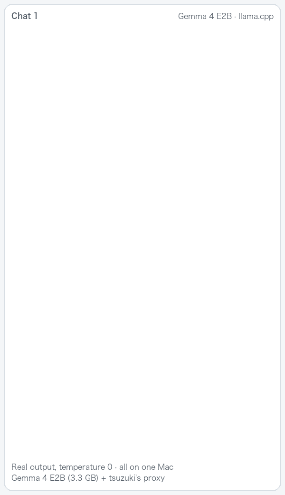
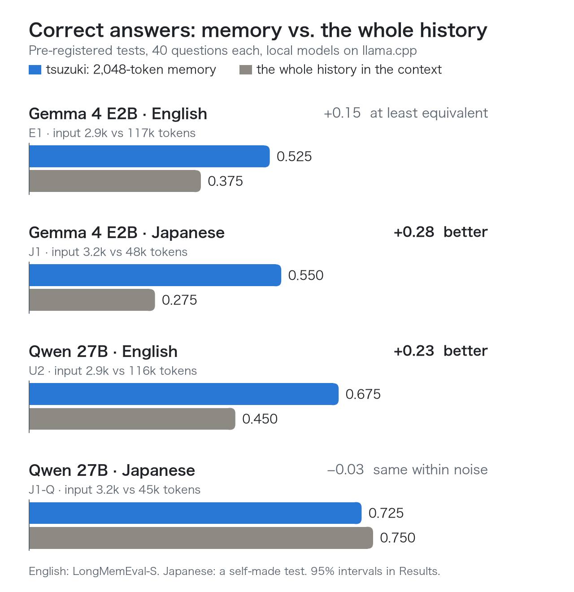

# tsuzuki: local long-term memory for agents and chat apps

**Your AI remembers earlier conversations, and nothing leaves your machine.**

[](https://github.com/inko9191/tsuzuki/actions/workflows/ci.yml) · Apache-2.0 · [日本語の README](README.ja.md)

<p align="center"></p>

- **Remembers across chats.** Before each message, the model gets the relevant excerpts from earlier conversations, with their dates: at most 2,048 tokens, not the whole history, and nothing when no earlier message is alike.
- **Runs on your machine.** EmbeddingGemma 300m finds the excerpts, and a small local model (Gemma 4 E2B) pulls facts out of past conversations. Nothing is sent anywhere unless you point it at a cloud model (with an MCP client on a cloud model, such as Claude Desktop, what it recalls goes to that model).
- **Plugs into what you use.** Chat apps where you can set an OpenAI-compatible URL, such as Open WebUI, on llama.cpp, Ollama or LM Studio (no tool calls needed), MCP clients (Claude Desktop, Claude Code, Cursor, LM Studio, Jan, Cline), Hermes Agent, DeepSeek Harness, or any program over HTTP.
- **Starts with your history.** Import your ChatGPT or Claude export, and earlier conversations are remembered from day one.
- **Measured before it was claimed.** Every test below was pre-registered: the decision rules were fixed in writing before any answer was generated.

<p align="center">
<picture>
  <source media="(prefers-color-scheme: dark)" srcset="docs/images/results-en-dark.png">
  
</picture>
</p>

With the small Gemma 4 E2B, the memory answered at least as well as the whole history in English and better in Japanese. With Qwen 27B it was better in English and the same within noise in Japanese. Either way the model read 1/14 to 1/40 of the input. Intervals and limits: [Results](#results-pre-registered) and [What is not shown](#what-is-not-shown).

**Try it** (Node.js 22.19+ and llama.cpp; [details below](#quick-start-macos-linux-windows)):

```bash
git clone https://github.com/inko9191/tsuzuki
cd tsuzuki
node scripts/setup.mjs
```

The repository also contains **an unofficial inference engine for EmbeddingGemma models (not affiliated with Google)**, written in C++/Metal for Apple silicon.

## Quick start (macOS, Linux, Windows)

You need **Node.js 22 (22.19 or later) or 24+**, **llama.cpp** (its `llama-server`) and **git**. For Hermes Agent, nothing else (the installer uses Hermes' own Python):

| | Node.js | llama.cpp | git |
|---|---|---|---|
| macOS | `brew install node` | `brew install llama.cpp` | comes with the Xcode command line tools (`xcode-select --install`) |
| Windows | `winget install OpenJS.NodeJS.LTS` | `winget install llama.cpp`, or a build from [its releases](https://github.com/ggml-org/llama.cpp/releases) | `winget install Git.Git` |
| Linux | [nodejs.org](https://nodejs.org) (distribution packages are often too old) | a build from [its releases](https://github.com/ggml-org/llama.cpp/releases), or `brew install llama.cpp` | your package manager (`apt install git`) |

On Windows, open a new terminal after `winget install`: the new programs are on `PATH` only there.

Then:

```bash
git clone https://github.com/inko9191/tsuzuki
cd tsuzuki
node scripts/setup.mjs
```

The script:
1. asks where you use the memory (the table below) and how much to set up: **quick** (search only: 334 MB, about 5 minutes) or **full** (with facts: 3.7 GB in all, 15–30 minutes the first time, mostly the download);
2. builds the plugins;
3. downloads the models, asking first: **EmbeddingGemma 300m** (334 MB, for search; under the [Gemma Terms of Use](https://ai.google.dev/gemma/terms)) and, for full, **Gemma 4 E2B** (3.35 GB, Apache 2.0; it pulls facts out of past conversations, which keeps recall better as conversations pile up);
4. connects the memory where you use it;
5. checks, in a throwaway store, that a message from one conversation is recalled in another and that facts are extracted, then shows it on your machine: a new chat answers from an earlier one, next to the same model without memory.

It speaks English or Japanese (your system's language, or `--lang ja`), and every error says what to do next.

| You use | Type | How the memory works there |
|---|---|---|
| A chat app on your own model server (llama.cpp, Ollama, LM Studio...) | `chat` | A proxy in front of the model server. In the app, set the OpenAI-compatible URL to `http://127.0.0.1:8293/v1` and the API key to the token setup prints (it is `token` in `~/.tsuzuki/config.json`). In Open WebUI: Admin Panel → Settings → Connections, add an OpenAI API connection. Every chat is stored, and earlier chats are recalled before each message, with no tool calls: the way memory was tested, and the choice for small local models, which often do not call tools reliably. |
| Claude Desktop, Claude Code, Cursor, LM Studio, Jan, Cline, or another MCP client | `mcp` | Setup prints what to add to the client's MCP settings (for Claude Code, one `claude mcp add` command). The model gets the tools `recall` and `remember` and decides when to call them; the server's instructions tell it when. Nothing is stored unless it calls `remember`. |
| Hermes Agent | `hermes` | Before each message the relevant memory is added, and every conversation is stored. Quit Hermes before the setup; then nothing else to start. |
| Your own program | `app` | The HTTP API of the memory server ([3d](#3d-anything-else-the-http-sidecar)). |

Setup asks for one of these words; `--for chat` (and so on) answers it ahead, for example in scripts. For `chat`, it also offers to start the memory server whenever you log in.

In every case the memory starts llama.cpp itself when it needs it and leaves it running for next time (about 0.5 GB of memory for search, about 4 GB more with facts); `node scripts/setup.mjs --stop` stops everything. Facts are made in the background about a minute after a conversation ends, and they run on your machine even when your agent uses a cloud model. Hermes and MCP clients say when a conversation ends; chat apps do not, so through the proxy a chat counts as ended after 5 quiet minutes (`proxy.segmentIdleMinutes`).

**About the proxy.**
- It works with apps where you can set the server URL and the API key: Open WebUI, and other apps with an "OpenAI-compatible" setting. LM Studio's and Ollama's own chat windows have no such setting, and llama-server's built-in web page talks to llama-server directly, so they get no memory (LM Studio can use the memory as an MCP client: `--for mcp`).
- The memory server must be running: setup starts it and offers to start it at login (`--autostart`); otherwise `node scripts/setup.mjs --start` starts it again after a restart of the computer.
- When no earlier message is alike, nothing is added: below a cosine of 0.31 with EmbeddingGemma 300m (`recall.minSimilarity`; [M2](#m2-no-memory-for-messages-that-need-none)). The memory server's log (`~/.tsuzuki/sidecar.log`) has one line per message: how many earlier messages were added and how alike the closest one was, never their text.
- The recall adds up to 2,048 tokens to each request. Give the model server room for it: Ollama's default context can be short (set `OLLAMA_CONTEXT_LENGTH`, for example 8192), and llama-server's is `-c`.
- A chat is recognized by its earlier messages (their role and text), not by the system prompt, so a prompt with the time in it or an app that drops old messages keeps one conversation; the history sent again with each message is stored once. A chat's first message always starts a new conversation, so two chats that open with the same words stay apart. The recall leaves out exactly the messages the app sent.
- Requests for the app's own background tasks (Open WebUI's titles and tags, which start with `### Task:`) and requests with the header `X-Memory: off` pass through without memory, as do `/v1/models` and other requests.
- The recall goes before the last user message, not into the system prompt, so the model server's prompt cache still covers the earlier messages.
- It accepts only a model server on this machine. Like the memory server, it refuses requests from web pages: an app that calls the model server from the browser page itself cannot use it. For an app in a Docker Desktop container, use `http://host.docker.internal:8293/v1` (not tested); on Linux, run the container with `--network=host` and use `127.0.0.1`.

Models go to `~/.tsuzuki/models`, the memory server's data to `~/.tsuzuki/memory` (Hermes: `<profile>/tsuzuki`). `node scripts/setup.mjs --help` lists the options (`--for chat|mcp|hermes|app`, `--quick`, `--upstream`, `--models`, `--llama-server`, `--report`, `--lang`, `--yes`, `--start`, `--stop`, `--autostart`, `--update`, `--version`, ...); running it again is safe and continues an interrupted download.

### Your memory from the terminal

`node scripts/memory.mjs` shows and changes what the memory keeps. It starts the memory server when it is not running; `--config <path>` picks another memory, such as a Hermes profile's `<profile>/tsuzuki/config.json`.

| Command | What it does |
|---|---|
| `status` | whether the memory server runs, and how many messages and facts it keeps |
| `recent [N]` | the last N conversations, newest first, with their ids |
| `show <id>` | the messages of one conversation |
| `search <words>` | the dated excerpts your model would get for these words |
| `forget <id>`, `forget --before 2026-01-01`, `forget --all` | delete, after asking (`--yes` skips the question) |
| `export [file]` | every message as JSON Lines: a backup |
| `import <file>` | your ChatGPT or Claude history (below) |

**Start with your ChatGPT or Claude history.** Ask the service for an export (ChatGPT: Settings → Data controls → Export data; Claude: Settings → Privacy → Export data), download the zip from the email, and give it as it is:

```bash
node scripts/memory.mjs import ~/Downloads/your-export.zip
```

- Each conversation is stored as one conversation, with its original dates. For ChatGPT, the branch you saw last is taken, not earlier edits or regenerated replies; hidden messages, tool calls and their output are left out. Images and files are not imported.
- It stays on this machine, and secrets are masked before storing, as for any message. Importing the same export again stores nothing twice.
- Recall works as soon as the messages are indexed (`status` shows what is left): on an M5 Max, 200 conversations with 4,000 messages were stored in 2 seconds and indexed in about 70. Facts are pulled out in the background, one conversation at a time: about 4 seconds each with Gemma 4 E2B on a fast Mac, so 1,000 conversations take about an hour; longer without a GPU.

### Keeping it running and up to date

- `node scripts/setup.mjs --autostart` starts the memory server when you log in (a LaunchAgent on macOS, a systemd user service on Linux, the Startup folder on Windows); `--autostart=off` stops that.
- `node scripts/setup.mjs --update` gets the newest version (`git pull`), rebuilds, restarts the memory server and shows what changed ([CHANGELOG](CHANGELOG.md)). Settings and memory are kept. Restart Hermes or your MCP client afterwards.
- `--start` and `--stop` start or stop it by hand.

### Removing it

1. `node scripts/setup.mjs --autostart=off`, then `node scripts/setup.mjs --stop` (the memory server and the llama.cpp servers it started).
2. Disconnect it: remove the `tsuzuki` entry from your MCP client's settings, point your chat app back at the model server, or, for Hermes, restore the `config.yaml` backup setup made next to it (or remove `memory.provider: tsuzuki`) and delete `<profile>/plugins/tsuzuki`.
3. Delete `~/.tsuzuki` (the models and the memory; Hermes: `<profile>/tsuzuki`) and this folder.

### Testing it on your machine

`node scripts/setup.mjs --report` runs the setup and prints a short report at the end: your OS, CPU, memory and GPU, llama.cpp's version and the devices it can use, and how long each step took. It is printed when setup fails, too, with the error. Your home folder and user name are taken out. Paste it into a [test report](https://github.com/inko9191/tsuzuki/issues/new?template=test-report.yml); a test only needs `--report --quick` (334 MB, about 5 minutes).

For DeepSeek Harness, your own model servers, Ollama, or this repository's Mac engine, see [Install (manual)](#install-manual). [CI](.github/workflows/ci.yml) runs this quick start end to end on Linux, Windows and macOS (GitHub's virtual machines, llama.cpp's official CPU builds), up to the check that a message from one conversation is recalled in another. Fact extraction is checked there on Linux only, and connecting Hermes (`--for hermes`) has been run only on a Mac. On Windows, file permissions are those of your user folder.

## What is in this repository

| Part | Path | What it does |
|---|---|---|
| Memory | `dsh-plugins/packages/tsuzuki` (npm name `dsh-tsuzuki`) | Stores the messages, extracts facts, searches, builds the recall block. One code base serves the dsh plugin and the sidecar (`tsuzuki-memory` command). |
| Embedding engine | `native/`, `server/`, `reference/` | Runs EmbeddingGemma (300m and 2) in C++/Metal and serves it through an OpenAI-compatible `/v1/embeddings` daemon (`egemma-server`). **Apple silicon only.** |
| dsh embedding providers | `dsh-plugins/packages/text-embeddings*` | `ctx.textEmbeddings` for dsh. `dsh-text-embeddings-tsuzuki` runs this engine; `dsh-text-embeddings-openai` uses any OpenAI-compatible endpoint, such as Ollama. |
| Hermes provider | `integrations/hermes/` | A Hermes Agent `MemoryProvider` (id `tsuzuki`) that talks to the sidecar. |
| Setup and the terminal | `scripts/setup.mjs`, `scripts/memory.mjs` | The one-command setup, and the memory from the terminal (also the ChatGPT / Claude import). |
| Evaluation | `docs/MEMORY_*`, `scripts/eval/`, `results/eval/memory/` | Pre-registrations, scripts and aggregate results. |

### How memory works

1. **Capture.** User and assistant messages go into a SQLite file. Subagent sessions are skipped. Secrets are redacted first (see [Privacy](#privacy)).
2. **Index.** Each message is embedded together with the message before it.
3. **Facts.** Each session is cut into segments of about 2,500 tokens, or wherever 30 minutes pass with no message (5 through the chat proxy), or where the host says the session ended. For each segment, a local chat model runs in the background:
   - it lists the facts the segment states, and each fact cites the messages it came from;
   - it adds update links, which mark a newer fact as replacing an older one.

   Facts are searched too, but only the **original messages** they cite are ever returned. The background work waits while the agent or the llama.cpp server is busy.
4. **Recall.** Before each new user message:
   - the message is embedded;
   - message windows and facts are ranked and fused (RRF);
   - when no window or fact of another session has a cosine of at least 0.31 with the message, nothing is added (the gate of M2; EmbeddingGemma 300m only, `recall.minSimilarity`);
   - otherwise the best messages from *other* sessions are selected, up to 2,048 tokens.

   They are shown in date order, under the current date and the rule "the most recent statement is current". There is no reranking by default. A message's text cannot close or open the `<memory>` block, and its second and later lines are indented, so a stored message cannot pose as instructions or as another excerpt (the evaluations rendered multi-line messages without that indentation).
5. **Tools.** `memory_search` (Hermes: `tsuzuki_search`) searches every session, including the current one (no rerank unless you turn it on). `memory_forget` (Hermes: `tsuzuki_forget`) deletes memory; it is **off by default** (see [Privacy](#privacy)).

## Results (pre-registered)

Every decision rule was fixed in writing before any answer was generated. The numbers below are copied from the report files in `results/eval/memory/`.

The plugin's defaults are the tested setting **P**. They were chosen in an earlier exploratory round (U1, 30 questions) and then confirmed in U2 on questions not used before.

**In short**
- **With a small local model** (Gemma 4 E2B), the memory answers at least as well as the whole history in the context in English (+0.150, E1, at least equivalent) and better in Japanese (+0.275, J1, better).
- **With a large local model** (Qwen 27B): English +0.225 over the whole ~116k-token history with the same template (U2-AT, better); on ~45k-token Japanese histories, the same accuracy within noise at 1/14 of the input and ~17× faster (J1-Q, inconclusive).
- **With thousands of stored sessions** accuracy falls. Facts (on whenever a local chat model is configured) win back part of it; a larger budget and reranking by a small model do not (S2, S3).
- **Messages that need no memory** (M2): a similarity gate cut the replies that refuse ("it is not in my memory") from 8.3% to 1.8% and all harmful replies from 14.9% to 6.4% with Gemma 4 E2B, at the same accuracy on questions that need memory (−0.7 points [−2.2, 0.0]). It is on by default since 0.2.1.

**Setup**
- **Data.** [LongMemEval](https://github.com/xiaowu0162/LongMemEval)-S, cleaned release. 40 new questions, drawn by ID and type only with a fixed seed: knowledge-update 10, temporal-reasoning 10, multi-session 10, single-session 6, abstention 4. That is 1,862 history sessions. The question IDs are in `results/eval/memory/longmemeval-u2-plan.json`.
- **Model.** Qwen3.8-27B Q4_K_M (GGUF) on llama.cpp `llama-server` (build b10964), thinking off. The same model answered, extracted the facts and checked the updates, and was the primary judge (LongMemEval's per-type judge prompts).
- **Embeddings.** EmbeddingGemma 300m, fp32, on this repository's Metal engine.
- **Hardware.** One Mac with Apple M5 Max and 64 GB of memory. The U2 and E1 files record the model hashes, the llama.cpp build and the server flags.
- **Statistics.** Paired percentile bootstrap over questions: 10,000 resamples, seed 0.

### U2: memory against the full history (Qwen 27B)

| Setting | What the model is given | Accuracy | Abstained | Input tokens (mean) | Answer time (mean) |
|---|---|---:|---:|---:|---:|
| **P** (tsuzuki's defaults) | recent history + 2,048-token date-aware recall | **0.675** | 0.250 | **2,913** | **5.7 s** |
| C512 (earlier frozen version) | recent history + 512-token recall, reranked | 0.475 | 0.525 | 1,218 | 3.0 s |
| A: full history | every session in a 131,072-token window, earlier frozen template (no question date) | 0.325 | 0.675 | 116,166 | 426.7 s |
| AT: full history, same template as P (U2-AT) | every session in date order, with the question date and P's rules | 0.450 | 0.425 | 116,289 | 431.2 s |

All 40 questions fit in the full-history window.

| Pre-registered comparison | Difference | 95% interval | Verdict | Wins / losses / ties |
|---|---:|---|---|---|
| P − C512 | +0.200 | [+0.075, +0.350] | improved (改善) | 9 / 1 / 30 |
| P − A | +0.350 | [+0.200, +0.500] | better (上回る) | 14 / 0 / 26 |
| P − AT (follow-up U2-AT) | +0.225 | [+0.100, +0.350] | better (上回る) | 9 / 0 / 31 |

So, on these 40 questions with this local model, the 2,048-token memory gave more correct answers than the whole ~116k-token history in the context, with about 40× fewer input tokens and about 75× less time per answer. The full history did better with P's date-aware template (AT − A: +0.125 [+0.025, +0.225], trend only), but still worse than P.

**Second judge (Claude).** Claude graded the U2 answers on sheets with the setting names hidden (Claude also designed the experiment, which is why the names were hidden):
- accuracy P 0.725, C512 0.475, A 0.350; agreement with Qwen 0.960, Cohen's κ 0.918;
- P − C512 +0.250 [+0.100, +0.400]; P − A +0.375 [+0.225, +0.525].

Claude graded the AT answers alone, so that setting could not be hidden: AT 0.525; P − AT +0.200 [+0.050, +0.350] (上回る); agreement with Qwen 0.925, κ 0.85.

**By question type** (Qwen judge; 4–10 questions each, so trends only)

| Setting | knowledge-update | multi-session | single-session | temporal-reasoning | abstention |
|---|---:|---:|---:|---:|---:|
| P | 0.80 | 0.70 | 0.50 | 0.50 | 1.00 |
| C512 | 0.60 | 0.40 | 0.50 | 0.20 | 1.00 |
| A | 0.50 | 0.10 | 0.50 | 0.00 | 1.00 |
| AT | 0.70 | 0.40 | 0.50 | 0.00 | 1.00 |

### E1: a small model (Gemma 4 E2B) as the reader

Same 40 questions ([`docs/MEMORY_LONGMEMEVAL_E1_PREREG.md`](docs/MEMORY_LONGMEMEVAL_E1_PREREG.md)). Gemma 4 E2B (Google's QAT q4_0 GGUF, 131,072-token window) answered. **E2B-P received exactly the messages Qwen's P received in U2**: the memory itself was built by the Qwen 27B pipeline; only the reader changed. All 40 E2B-AT inputs fit the window. Primary judge: Qwen.

| Setting | Accuracy | Abstained | Input tokens | Answer time |
|---|---:|---:|---:|---:|
| E2B-P (Gemma 4 E2B + memory) | **0.525** | 0.025 | 2,942 | 1.0 s |
| E2B-AT (Gemma 4 E2B + full history, same template) | 0.375 | 0.075 | 117,101 | 98.3 s |
| reference: Qwen 27B P (U2) | 0.675 | | | |
| reference: Qwen 27B AT (U2-AT) | 0.450 | | | |

- **Product bar** (E2B-P ≥ 0.50): **met**.
- **Primary, E2B-P − Qwen-AT** (small model + memory against the large model + full history): +0.075 [−0.100, +0.250], **inconclusive** (判定不能), 8 / 5 / 27.
- E2B-P − E2B-AT: +0.150 [−0.025, +0.300], at least equivalent (同等以上（非劣性）), 9 / 3 / 28.
- E2B-P − Qwen-P: −0.150 [−0.325, +0.000], trend only: the cost of the smaller reader.
- Second judge (Claude, blinded, graded before opening the Qwen labels): E2B-P 0.650, E2B-AT 0.475, Qwen-AT 0.525; E2B-P − Qwen-AT +0.125 [−0.025, +0.275] and E2B-P − E2B-AT +0.175 [+0.000, +0.350], both at least equivalent (同等以上（非劣性）); agreement with Qwen 0.887, κ 0.78. The primary verdict stays the Qwen judge's: inconclusive.

### J1: Japanese, everything on Gemma 4 E2B

A self-made Japanese test ([`docs/MEMORY_JA_J1_PREREG.md`](docs/MEMORY_JA_J1_PREREG.md)): no public Japanese long-term memory benchmark was found, so 40 questions were written with their answer sessions and hard negatives (answers fixed by construction), mixed into ~47 generic Japanese chats per question (~48k tokens). **Everything a small machine would run is Gemma 4 E2B**: fact extraction, update links and reading. Only the judge is Qwen 27B.

| Setting | Accuracy | Input tokens | Answer time |
|---|---:|---:|---:|
| E2B-P (memory, all E2B) | **0.550** | 3,190 | 0.9 s |
| E2B-AT (full history, same template) | 0.275 | 47,689 | 20.2 s |

- **Primary, E2B-P − E2B-AT**: +0.275 [+0.150, +0.425], **beats full context** (上回る), 11 / 0 / 29. Product bar met.
- The memory contained every answer session for all 40 questions (coverage 1.00): retrieval held in Japanese; the misses are reading and reasoning (temporal 0.12, multi-session counting 0.25).
- Second judge (Claude, blinded): 0.700 vs 0.425, +0.275 [+0.125, +0.425], beats full context; agreement 0.850, κ 0.71.
- A self-made test is cleaner than real chats; read it as a check that the method carries over to Japanese, not as a benchmark score.

### J1-Q: the same Japanese test, everything on Qwen 27B

The follow-up that J1's rule triggered ([`docs/MEMORY_JA_J1Q_PREREG.md`](docs/MEMORY_JA_J1Q_PREREG.md); run log [`docs/MEMORY_JA_J1Q_RUNLOG.md`](docs/MEMORY_JA_J1Q_RUNLOG.md)): the memory built and read by Qwen3.8 27B.

| Setting | Accuracy | Input tokens | Answer time |
|---|---:|---:|---:|
| Qwen-P (memory) | 0.725 | 3,205 | 5.8 s |
| Qwen-AT (full history, same template) | 0.750 | 45,311 | 99.4 s |

- **Primary, Qwen-P − Qwen-AT**: −0.025 [−0.100, +0.050], **inconclusive** (判定不能), 1 / 2 / 37.
- A large model reads ~45k tokens of Japanese history about as well as it reads the memory. Here the memory's gain is cost (1/14 of the input, ~17× faster), not accuracy; with the small model (J1) the memory was clearly more accurate.
- Second judge (Claude, blinded): 0.825 vs 0.850, −0.025 [−0.100, +0.050], inconclusive; agreement 0.900, κ 0.71.

### S2 and S3: 5,000 stored sessions, answered by Gemma 4 E2B

The scale test (below) showed recall falling as unrelated history piles up. S2 and S3 measured **answers** at 5,000 stored sessions (~52k messages) with Gemma 4 E2B as the reader, on 60 LongMemEval-S questions not used before (10 per non-abstention type), each with its answer sessions at their own dates among the filler sessions ([`docs/MEMORY_SCALE_S2_PREREG.md`](docs/MEMORY_SCALE_S2_PREREG.md), [`docs/MEMORY_SCALE_S3_PREREG.md`](docs/MEMORY_SCALE_S3_PREREG.md), run log [`docs/MEMORY_SCALE_S3_RUNLOG.md`](docs/MEMORY_SCALE_S3_RUNLOG.md)).

| Recall at 5,000 sessions | Accuracy | Answer message in the recall | Against windows only |
|---|---:|---:|---|
| message windows only (what dsh recalls without a chat model) | 0.317 | 0.483 | |
| budget 8,192 | 0.267 | 0.733 | −0.050 [−0.133, +0.033], inconclusive |
| E2B reranks the top 30 windows (the shipped option) | 0.267 | 0.417 | −0.050 [−0.133, +0.017], inconclusive |
| E2B reranks the top 100 windows | 0.250 | 0.350 | −0.067 [−0.133, −0.017], **worse** |
| date filter read from the question | 0.317 | 0.483 | ±0 (it applied to 4 of 60 questions) |
| **facts: setting P (S3)** | **0.400** | 0.667 | +0.083 [−0.017, +0.183], inconclusive, 7 / 2 |
| reference: windows only at 50 sessions | 0.433 | 0.850 | |

- More text does not help a small reader: the 8,192 budget put the answer in front of E2B more often, but it answered worse. As a reranker, E2B chose worse passages than the dense order, so **rerank is off by default**, for `memory_search` too.
- Facts (setting P, with the facts extracted and update-checked by E2B itself) pointed the same way in every comparison: +0.083 here, +0.050 on a second set of 60 questions, +0.067 at 50 sessions (19 wins, 7 losses in all), but no interval excludes zero. At 5,000 sessions P (0.400) is close to windows-only at 50 sessions (0.433).
- Building the facts of 5,000 sessions took E2B about 3.7 hours on the M5 Max (7,074 segments, 8 requests at a time). In normal use this runs in the background after each conversation, one request at a time: a median of 4.2 s per conversation, 7.9 s at the 90th percentile (60 LongMemEval-S conversations of about 2,200 tokens; [`results/eval/memory/write-cost-report.md`](results/eval/memory/write-cost-report.md), in Japanese). An earlier version of this README said about 10–14 s: that was the time of one request while 8 shared the GPU.
- Second judge (Claude, blinded samples of 90 answers): agreement 0.978 (κ 0.95) in S2 and 0.944 (κ 0.89) in S3.

### M2: no memory for messages that need none

Most messages need no memory, but recall always added the closest excerpts, however unrelated. Gemma 4 E2B then refused ordinary requests ("it is not in my memory") or carried an unrelated earlier topic into its answer. M2 ([`docs/MEMORY_MISFIRE_M2_PREREG.md`](docs/MEMORY_MISFIRE_M2_PREREG.md); results [`docs/MEMORY_MISFIRE_M2_RESULTS.md`](docs/MEMORY_MISFIRE_M2_RESULTS.md)) tested a gate: nothing is added when the closest earlier message has a cosine below τ\* = 0.31 with the message. τ\* was set on separate users before the test. The test had 136 new users: 96 with English LongMemEval-S histories and 40 from a new self-made Japanese set (J2). They had 1,088 messages that need no memory and 136 questions that do. Gemma 4 E2B answered, with message windows only (quick).

| | Refusals | Harmful replies (refusals, or unrelated memory brought in) | Accuracy on the questions |
|---|---:|---:|---:|
| no memory | 0.1% | 0.4% | 8.1% |
| memory without the gate (0.2.0) | 8.3% | 14.9% | 52.2% |
| **memory with the gate (0.2.1)** | **1.8%** | **6.4%** | **51.5%** |

- Both pre-registered rules held: refusals −6.4 points [−8.0, −5.0]; accuracy −0.7 [−2.2, 0.0], within the −5-point margin.
- The gate still added memory to 96% of the questions and to 68% of the other messages; one question lost its answer.
- In Japanese it changed almost nothing: the Japanese messages shared topics with the histories, so 80% passed, and they had little harm to begin with. The harm that is left (6.4%) is almost all English: an earlier topic carried into an unrelated question, or an earlier reply's style copied.
- Second judge (Claude, blinded): κ 0.69 with the Qwen judge.
- 0.31 holds for EmbeddingGemma 300m, so with other embedding models the gate is off unless you set it. Facts (full) were not part of the test.

Full tables, with the V1024R and T2048 ablations:
- [`results/eval/memory/longmemeval-u2-report.md`](results/eval/memory/longmemeval-u2-report.md), [`longmemeval-u2-at-report.md`](results/eval/memory/longmemeval-u2-at-report.md), [`longmemeval-e1-report.md`](results/eval/memory/longmemeval-e1-report.md), [`j1-report.md`](results/eval/memory/j1-report.md), [`j1q-report.md`](results/eval/memory/j1q-report.md), [`s2-report.md`](results/eval/memory/s2-report.md), [`s3-report.md`](results/eval/memory/s3-report.md), [`m2-report.json`](results/eval/memory/m2-report.json); exploratory: [`scale-diagnosis.md`](results/eval/memory/scale-diagnosis.md), [`scr1-report.md`](results/eval/memory/scr1-report.md)
- [`longmemeval-u2-claude-judge.md`](results/eval/memory/longmemeval-u2-claude-judge.md), [`longmemeval-u2-at-claude-judge.md`](results/eval/memory/longmemeval-u2-at-claude-judge.md), [`longmemeval-e1-claude-judge.md`](results/eval/memory/longmemeval-e1-claude-judge.md), [`j1-claude-judge.md`](results/eval/memory/j1-claude-judge.md), [`j1q-claude-judge.md`](results/eval/memory/j1q-claude-judge.md), [`s2-claude-judge.md`](results/eval/memory/s2-claude-judge.md), [`s3-claude-judge.md`](results/eval/memory/s3-claude-judge.md)
- Pre-registrations: [`docs/MEMORY_LONGMEMEVAL_U2_PREREG.md`](docs/MEMORY_LONGMEMEVAL_U2_PREREG.md), [`docs/MEMORY_LONGMEMEVAL_U2_AT_PREREG.md`](docs/MEMORY_LONGMEMEVAL_U2_AT_PREREG.md), [`docs/MEMORY_LONGMEMEVAL_E1_PREREG.md`](docs/MEMORY_LONGMEMEVAL_E1_PREREG.md), [`docs/MEMORY_MISFIRE_M2_PREREG.md`](docs/MEMORY_MISFIRE_M2_PREREG.md) (the documents are in Japanese)

### About the pre-registrations

This public repository starts from a fresh snapshot (its first commit); later commits are listed in [`docs/SANITIZED.md`](docs/SANITIZED.md). The pre-registrations were committed **before** the results in the author's private development repository; that history is not part of this repository, so it cannot show the order here. What you can check here: each `*-plan.json` in `results/eval/memory/` records the sha256 of its pre-registration document and of the code it ran, and these files are byte-identical to the private repository, except the few listed with both hashes in [`docs/SANITIZED.md`](docs/SANITIZED.md). The original commit history is available on request.

## What is **not** shown

- **Coding and working memory.** `working.enabled` stores tool calls and results and, after dsh compacts the context, gives back the details the summary dropped. It is **experimental and off by default**. The pre-registered test C1 ([`docs/MEMORY_CODING_C1_PREREG.md`](docs/MEMORY_CODING_C1_PREREG.md)) was **stopped without a verdict**: dsh's own summaries were unreliable with the local Qwen 27B at a 32k window, so it would have measured the summaries, not the memory.
- **Japanese beyond a self-made test.** J1 and J1-Q (above) use a small self-made test; no real Japanese user conversations were measured.
- **Thousands of sessions.** In a retrieval-only scale test ([`results/eval/memory/scale-report.md`](results/eval/memory/scale-report.md), in Japanese; LongMemEval-S sessions, message windows only, no facts, no rerank), the share of 60 questions whose answer message was in the recall fell from 0.883 at 50 stored sessions to 0.717 at 500, 0.667 at 2,000 and 0.517 at 5,000 (5,000 − 50: −0.367 [−0.483, −0.250]). **Accuracy falls as unrelated history accumulates.** S2 and S3 (above) measured answers at 5,000 sessions: facts win back part of it; a larger budget and reranking by a small model do not. Nothing beyond 5,000 sessions was measured.
- **Real long-term use.** These tests use benchmark histories, not months of real conversations.
- **Other hardware and the non-Mac path.** Everything was measured on one Mac. The llama.cpp embedding path (EmbeddingGemma 300m, Q8_0 GGUF) was checked against the fp32 engine on that Mac ([`scripts/eval/scale/llamacpp_parity.mjs`](scripts/eval/scale/llamacpp_parity.mjs)): cosine ≥ 0.9997 on 200 message windows and 60 questions, top-10 overlap 0.992, and the same scale-test recall at 500 sessions (0.717 and 0.717) and at 5,000 sessions (0.517 and 0.517). On Linux and Windows it has been run only in CI (GitHub's virtual machines, CPU builds): it works end to end there, but recall quality has **not** been measured on them. The Ollama path has **not** been measured; Ollama's build of EmbeddingGemma 300m may differ numerically from the fp32 engine. EmbeddingGemma 2 has not been measured in setting P (an exploratory LoCoMo check put its retrieval 0.03 recall@10 below 300m).
- **Other models.** In U2 the answering model, the fact extractor and the judge were all the same local Qwen3.8-27B Q4_K_M. E1 changed only the reader. Cloud models with stronger long-context ability were not tested; such a model could narrow or reverse the gap against the full history.
- **Imported histories.** Importing ChatGPT or Claude exports was checked to work (tests with exports of both formats), but recall on real imported histories, which mix many topics and years, has not been measured.
- **The proxy and MCP clients.** The proxy uses the tested recall (message windows and facts, 2,048 tokens, before the user's message), but placed in the conversation the app sends rather than in the evaluation template; its effect on answers has not been measured. With MCP clients the model decides when to recall and what to remember; that has not been measured either. Both were checked to work: with Gemma 4 E2B behind the proxy, a new chat answered from an earlier one (in English and in Japanese), and the MCP server was checked with the official MCP Python SDK. They were not tried with each app listed above.
- **Write-time cost.** The answer times do not include the background work when messages are stored (fact extraction and update checks with the chat model, plus embedding; with Gemma 4 E2B on the M5 Max a median of 4.2 s per conversation, one at a time). The full-history times were measured with llama.cpp's host prompt cache off.
- **Comparison with published LongMemEval scores.** Not comparable: published scores use a GPT-4o judge and other models.
- **The gate beyond M2.** The gate's 0.31 was measured with EmbeddingGemma 300m, message windows only, on each conversation's first message; not with facts (full), other embedding models, or later messages of a chat.
- **Precision.** 40 questions give wide intervals. In U2 the primary judge is the same model that answered; the second judge is there to check that.

## Requirements (manual install)

The [quick start](#quick-start-macos-linux-windows) needs only Node.js, llama.cpp and git. For the manual install:

- **Node.js** `^22.19` or `>=24`. dsh and the sidecar use `node:sqlite`.
- **A chat endpoint for facts.** OpenAI-compatible, with JSON-schema output. Tested: llama.cpp `llama-server` with Qwen3.8-27B Q4_K_M. Without one, memory still works on message windows only; that is **not** the tested setting P.
- **Embeddings.** One of:
  - **Mac with Apple silicon** (the tested path): this repository's engine, running EmbeddingGemma 300m in fp32. You need Xcode, CMake, Python 3.13 and [uv](https://github.com/astral-sh/uv).
  - **Any other machine**: llama.cpp's `llama-server` with the EmbeddingGemma 300m GGUF (checked against the engine), or [Ollama](https://ollama.com) with `embeddinggemma` (not measured).
- **For Hermes Agent**: Hermes' bundled Node (`~/.hermes/node/bin/node`) or another Node as above.

## Install (manual)

### 1. Build the plugins (all hosts)

```bash
cd dsh-plugins
npx -y pnpm@10.26.1 install --frozen-lockfile
npx -y pnpm@10.26.1 run build
npx -y pnpm@10.26.1 -r --filter './packages/*' pack --pack-destination dist
```

This writes the dsh packages to `dsh-plugins/dist/*.tgz`, and the sidecar to `dsh-plugins/packages/tsuzuki/lib/server.js`. The packages are not on npm: always install the tarballs by **absolute path**, never by package name (a package of that name on npm would be installed instead).

### 2. Embeddings

**Mac (tested path).** From the repository root:

```bash
uv venv .venv --python 3.13   # uv downloads Python 3.13 if it is not installed
uv pip install --python .venv/bin/python -r requirements-lock.txt
cmake -S . -B build -DCMAKE_BUILD_TYPE=Release -DPython_EXECUTABLE="$PWD/.venv/bin/python"
cmake --build build -j 8
```

- `requirements-lock.txt` gives the exact versions used for the results. It also installs the validation stack (PyTorch, transformers).
- EmbeddingGemma 300m is gated under the [Gemma Terms of Use](https://ai.google.dev/gemma/terms). Accept them on the [model page](https://huggingface.co/google/embeddinggemma-300m), log in with `.venv/bin/hf auth login`, then download the evaluated revision:

```bash
.venv/bin/hf download google/embeddinggemma-300m --revision 57c266a740f537b4dc058e1b0cda161fd15afa75 --local-dir models/embeddinggemma-300m
```

You do not need to start the engine yourself: the dsh provider and the sidecar start it on `127.0.0.1:8299` when they need it.

**Linux, Windows, or a Mac without the engine: llama.cpp** (checked against the engine, see "What is not shown"). Download the GGUF (this also accepts the Gemma Terms of Use; sha256 `b5ce9d77a3fc4b3b39ccb5643c36777911cc4eb46a66962eadfa3f5f60490d63`, 334 MB) and start an embedding server on port 8291:

```bash
hf download ggml-org/embeddinggemma-300M-GGUF embeddinggemma-300M-Q8_0.gguf --local-dir models
llama-server -m models/embeddinggemma-300M-Q8_0.gguf --embedding -c 8192 -np 4 -b 2048 -ub 2048 --host 127.0.0.1 --port 8291 --alias tsuzuki-embeddinggemma
```

`-c 8192 -np 4` gives each of the 4 slots 2,048 tokens, EmbeddingGemma's input limit, and `-ub 2048` lets one input fill a slot. (`hf` comes with `pip install huggingface_hub`; or download the file from the model page.) Port 8291 and the alias are what the memory server uses when it starts llama.cpp itself (setup's way), so either can use a server the other started; 8080 stays free for your chat server.

**Or Ollama** (not measured against the engine; pulling also accepts the Gemma Terms of Use):

```bash
ollama pull embeddinggemma
```

### 3a. DeepSeek Harness (CLI profile)

Install into a profile that already runs, or one of the shipped templates (`web`, `headless`, `acp`, `sdk`, `sdk-minimal`). Any other new name gives an empty profile that loads only `dsh-base`, so create a new profile from a template first:

```bash
dsh --profile <name> --from-default-profile headless --dump-config > /dev/null   # only for a new name; or web, acp, sdk, sdk-minimal
```

`dsh plugin` runs pnpm inside the profile directory, so pass **absolute** paths. From the repository root:

```bash
dist="$PWD/dsh-plugins/dist"
v=$(node -p "require('./dsh-plugins/packages/tsuzuki/package.json').version")
dsh plugin --profile <name> add "$dist/dsh-text-embeddings-0.1.0.tgz" "$dist/dsh-text-embeddings-tsuzuki-0.1.0.tgz" "$dist/dsh-tsuzuki-$v.tgz"
```

Then add rows to `$DSH_HOME/profiles/<name>/cordis.patch.yml` (`~/.dsh/profiles/<name>/` unless you set `DSH_HOME`). In a new profile that file holds only `[]` (an empty list): replace the `[]` with the rows, or dsh cannot read the file. A patch replaces the row's whole `config`, so write every setting you need:

```yaml
- id: text-embeddings-tsuzuki
  disabled: false
  config:
    engineRoot: /absolute/path/to/this/repository
    modelDir: /absolute/path/to/this/repository/models/embeddinggemma-300m
    modelName: embeddinggemma-300m   # dtype "auto" -> fp32 for 300m
    port: 8299
- id: tsuzuki
  config:
    llm: { baseUrl: http://127.0.0.1:8080/v1 }   # your local chat server
```

**With llama.cpp or Ollama instead**, add `dsh-text-embeddings-openai-0.1.0.tgz` instead of `dsh-text-embeddings-tsuzuki-0.1.0.tgz`, and use this row (`baseUrl` `http://127.0.0.1:8291/v1` for llama.cpp as above, `http://127.0.0.1:11434/v1` for Ollama):

```yaml
- id: text-embeddings-openai
  disabled: false
  config:
    baseUrl: http://127.0.0.1:8291/v1   # llama.cpp; Ollama: http://127.0.0.1:11434/v1
    model: embeddinggemma
    dimensions: 768
    taskPrefixes:
      query: 'task: search result | query: '
      document: 'title: none | text: '
```

**Turn off other memory.** If the profile has another memory plugin, disable its row (`- id: <its row id>` with `disabled: true`) so that memory is not recalled twice.

Memory is stored in `$DSH_HOME/tsuzuki`.

**Expected warnings** (harmless): pnpm reports "Issues with peer dependencies found" for the `@deepseek-ai/*` packages, and dsh says `dsh-text-embeddings` "declares no dsh.bundle" (dsh supplies those packages, and that package has no row of its own). At run time, Node prints `ExperimentalWarning: SQLite is an experimental feature` once.

**Check that it works.** Start two sessions: tell the agent something in the first, ask about it in the second. The second request carries a `<memory>` block. The store is `$DSH_HOME/tsuzuki/memory.db`.

### 3b. DeepSeek Harness desktop app

Quit the app first, then run `bash dsh-plugins/scripts/install-desktop.sh` (add `llamacpp` or `ollama` as an argument to use llama.cpp on port 8291 or Ollama for embeddings; a second argument sets another local URL). The script backs up the profile files and prints how to undo the change. Memory is stored in `$DSH_HOME/tsuzuki` (`~/.dsh/tsuzuki` by default).

### 3c. Hermes Agent

Before you start:
- **Build the plugins** (step 1). The sidecar runs on Hermes' bundled Node (`~/.hermes/node/bin/node`); without it, on the `node` on your `PATH`, or set `memory.tsuzuki.node` in the profile's `config.yaml`.
- **Embeddings.** With the Mac engine built (step 2), the installer uses it. Otherwise it writes an Ollama configuration and says so: make sure Ollama runs on `127.0.0.1:11434` with `embeddinggemma` pulled. For llama.cpp (step 2), pass `--embedding llamacpp` (port 8291; `--embedding-url` for another local port).
- **Facts.** The installer uses the profile's own model endpoint (`model.base_url`) for fact extraction, but only when it is on this machine (see [Privacy](#privacy)). For a remote endpoint it stops and changes nothing: re-run with `--no-chat` (message windows only, not the tested setting P), or with `--allow-remote-chat` if you accept that conversation text is sent there.

Quit Hermes, then run (the profile must already have a `config.yaml`; `default` is the Hermes home itself):

```bash
python3 integrations/hermes/install.py <profile>            # --home <dir> when Hermes is not in ~/.hermes
```

For each profile, the script backs up `config.yaml`, copies the provider to `<profile>/plugins/tsuzuki`, sets `memory.provider: tsuzuki`, and writes `<profile>/tsuzuki/config.json` (kept if it exists). Each profile gets its own sidecar port (`8297` + a hash of the data directory, so `8297`–`8796`), so profiles do not share memory. Restart Hermes, then run `hermes memory status`.

**Check that memory really works.** `hermes memory status` only checks that Node and the sidecar script exist. After one conversation, `curl -s -H "Authorization: Bearer <token>" http://127.0.0.1:<port>/health` (the port and the token are in `config.json`) must show `embedding.ok: true`, `stats.turns` above 0, and `stats.unindexed` back at 0 a few seconds later.

**Changing `config.json` later.** The sidecar keeps running after Hermes quits and reads `config.json` only when it starts. Stop it (`kill $(lsof -t -iTCP:<port> -sTCP:LISTEN)`), then start Hermes again.

Details (in Japanese): [`integrations/hermes/README.md`](integrations/hermes/README.md).

### 3d. Anything else: the HTTP sidecar

```bash
node dsh-plugins/packages/tsuzuki/lib/server.js --config <dir>/config.json
```

(The packed `dsh-tsuzuki` package installs the same server as the `tsuzuki-memory` command; without `--config` it uses `~/.tsuzuki/config.json`.)

On the first start, the sidecar writes a default `config.json` next to the data: port `8297`, embeddings from Ollama `embeddinggemma`, **no chat model**. For the tested setting, set `chat.baseUrl` and `chat.model` (use `chat.server: "openai"` for servers other than llama.cpp). For llama.cpp embeddings (step 2), set `"embedding": {"baseUrl": "http://127.0.0.1:8291/v1", "model": "embeddinggemma"}`. To use the Mac engine instead, add:

```json
"embedding": {"engine": {"engineRoot": "/abs/repo", "modelDir": "/abs/repo/models/embeddinggemma-300m", "modelName": "embeddinggemma-300m", "port": 8299}}
```

The sidecar reads `config.json` only when it starts: after a change, stop it and start it again.

The proxy (`--for chat` sets it up) is part of the same server: `"proxy": {"enabled": true, "port": 8293, "upstream": "http://127.0.0.1:8080/v1", "apiKey": "", "segmentIdleMinutes": 5}`. `apiKey` is sent to the model server (the app's own key is the memory's token and is never forwarded); `upstream` must be on this machine unless `"allowRemoteUpstream": true`. The MCP server is `node dsh-plugins/packages/tsuzuki/lib/mcp.js [--config <path>] [--forget]`: it reads the same `config.json` and starts the sidecar when it is not running.

| Endpoint | Request | Response |
|---|---|---|
| `GET /health` | | `{status, version, pid, dataDir, stats, embedding, chat}`: `embedding` and `chat` are `{url, ok, lastError, lastErrorAt}`; `stats.unindexed` counts what is not embedded yet |
| `POST /v1/memory/messages` | `{session, messages: [{role, text, id?, at?}]}` | `{stored}`, as soon as the messages are stored |
| `POST /v1/memory/recall` | `{query, session?, budget_tokens?}`: current session excluded, no rerank | `{text, ids, reranked}`; `text` is the `<memory>` block, or `""` (also when nothing is at least `recall.minSimilarity` alike). `503 {error, cause}` when the query cannot be embedded |
| `POST /v1/memory/search` | `{query, budget_tokens?, rerank?}`: all sessions, no gate (the MCP `recall` tool uses it) | same |
| `POST /v1/memory/flush` | `{session?}` | `{ok}` |
| `POST /v1/memory/forget` | exactly one of `{session}`, `{before}`, `{all: true}` | `{turns, units, facts, segments, links, vacuumed}` |

Send `Content-Type: application/json` and, when `config.json` has a `token` (a config the sidecar or the Hermes installer writes gets a random one), `Authorization: Bearer <token>`. A body that is not a JSON object is a `400`; one over 8 MB is a `413`.

**When a model hangs or is down**, nothing waits long: a recall gives up after about 3.5 s (the query embedding has 3 s, and after a timeout further queries fail at once for 30 s), a search's rerank, when turned on, after 15 s (at once when the chat server does not answer at all, keeping the dense order), and messages are stored even while the embedding model is down; they are indexed as soon as it answers again.

## Main settings

| Setting (dsh name / sidecar name) | Default | Meaning |
|---|---|---|
| `recall.budgetTokens` | `2048` | Size of the memory block per turn (setting P) |
| `recall.minSimilarity` | unset: `0.31` with EmbeddingGemma 300m, off with other models | Add nothing when no message of another session is at least this alike (cosine; M2). `0` turns it off. Searches the model asks for are not gated |
| `recall.rerank` | `false` | dsh only: rerank recall with the chat model. Costs about 16 s per query on a local 27B model. |
| `tool.rerank` / `search.rerank` | `false` | Rerank `memory_search` / `POST /v1/memory/search` with the chat model. Off: with Gemma 4 E2B it lowered answers (S2), and setting P has no rerank. |
| `embedding.queryTimeoutMs` | `3000` | Limit of one query embedding (recall, search) |
| `llm.rerankTimeoutMs` / `chat.rerankTimeoutMs` | `15000` | Limit of one rerank; then the dense order is used |
| `llm.baseUrl` / `chat.baseUrl` | dsh: `http://127.0.0.1:8080/v1`; sidecar: empty | Chat endpoint for facts and rerank. Empty turns both off. |
| `facts.updateLinks` | `true` | Write-time update links |
| `facts.segmentIdleMinutes` / `proxy.segmentIdleMinutes` | `30` / `5` | Minutes of quiet after which a conversation's open part becomes a segment for facts (`proxy.*`: chats through the proxy) |
| `capture.redactSecrets` | `true` | Redact secrets before storing (and in queries) |
| `tool.forget` (Hermes: `memory.tsuzuki.forget` in `config.yaml`) | `false` | Offer the forget tool to the model |
| `working.enabled` | `false` | Working memory for long coding tasks (experimental) |

Full list: [`dsh-plugins/packages/tsuzuki/README.md`](dsh-plugins/packages/tsuzuki/README.md).

## Privacy

- **Local by default.** Messages are kept in a local SQLite file. Embeddings come from `127.0.0.1` (the engine, llama.cpp or Ollama); the installers accept only local embedding URLs. Facts come from the chat endpoint you configure. There is no telemetry.
- **Your text leaves the machine if you point an endpoint at a cloud service.** If `llm.baseUrl` / `chat.baseUrl` or the embedding `baseUrl` is a remote API, stored messages and fact segments are sent there.
  - The Hermes installer uses the profile's model endpoint only when it is on this machine; for a remote one it stops unless you pass `--allow-remote-chat` (or `--no-chat`).
  - dsh's `llm.baseUrl` defaults to `http://127.0.0.1:8080/v1`. Make sure that port is your local chat server, or set it.
- **Secret redaction** is on by default. Before anything is stored, embedded or sent to the fact model (queries too), these become `[REDACTED:KIND]`: API keys and tokens (OpenAI, Anthropic, GitHub, GitLab, Hugging Face, AWS, Google, Slack and Slack webhooks, Stripe, npm, SendGrid, Discord), JWTs, bearer and Basic credentials, credentials inside URLs, `password:`/`OPENAI_API_KEY=`/`token:`-style values (including Japanese labels such as パスワード, and "my password is …" when the value has a digit or a symbol), and Luhn-valid card numbers. It is pattern-based and favours precision. **Unusual secrets can slip through.** Do not paste secrets into chats and count on it.
- **MCP clients** send what `recall` returns to their model, as part of the conversation: with a cloud model (Claude Desktop, Claude Code, Cursor...), excerpts of earlier conversations go to that provider.
- **The proxy** sends your chats, with the recalled memory, to the model server you set. It refuses a model server on another machine unless you allow it in the config. It uses the same token and the same checks as the sidecar (it also accepts the host name `host.docker.internal`, for apps in Docker Desktop).
- **The sidecar.** It listens on `127.0.0.1` only and rejects requests that are not JSON, that carry a browser `Origin`, or that use a `Host` other than loopback (so web pages cannot use it). A config it writes itself, or the Hermes installer writes, has a random `token`: programs that cannot read that file (other users, sandboxes) are refused. Clients (the MCP server, the terminal commands, setup, the Hermes provider) first ask it to prove that it knows the token, without sending it (`GET /health?nonce=`): a program that took the port while the memory was down gets neither the token nor a conversation. A config without a `token` (written by hand, or before this version) lets any program on the machine use it. Another `host` than loopback requires a `token`.
- **Files.** The memory folder is created readable by you only (0700), the SQLite file and its WAL as 0600, `config.json` as 0600. The embedding engine (`egemma-server`) applies the same Origin, Host and JSON checks.
- **Forgetting.** The tools `memory_forget` (dsh), `tsuzuki_forget` (Hermes) and `forget` (MCP) are **off by default**: the tool tells the model to state the exact scope and call it only after the user has confirmed it, but that is an instruction to the model, which a web page or pasted text could override. Turn them on with `tool.forget: true` (dsh), `memory.tsuzuki.forget: true` in the Hermes profile's `config.yaml`, or `--forget` in the MCP server's arguments. Other hosts use `POST /v1/memory/forget`. Three scopes: one session, everything captured before a date, or everything. The messages, the windows and facts made from them and their update links are deleted, and the SQLite file and its WAL are rewritten, so the text is gone from the file too. There is no per-message delete. Not covered: the host's own session history, copies or backups of the store, and what the local servers have already seen. To erase everything by hand, stop the host and delete the memory directory: dsh `$DSH_HOME/tsuzuki`; Hermes `<profile>/tsuzuki`; sidecar the `dataDir` of its `config.json` (setup: `~/.tsuzuki/memory`; the models in `~/.tsuzuki/models` are separate).

## Model licenses

No model weights are included in this repository or its packages.

- **EmbeddingGemma 300m** (`google/embeddinggemma-300m`), the model behind every number above, is under the [Gemma Terms of Use](https://ai.google.dev/gemma/terms). It is **not bundled**: you accept the terms when you download it from Hugging Face (the original or the GGUF) or with `ollama pull`. The sidecar's automatic Ollama pull refuses to fetch it unless you set `embedding.acceptModelLicense: true`.
- **EmbeddingGemma 2** (`google/embeddinggemma-2`): Apache 2.0, according to its model card, which also points to the Gemma Prohibited Use Policy. The engine supports it (fp16 by default); it has not been measured in setting P.
- **Gemma 4 E2B** (`google/gemma-4-E2B-it-qat-q4_0-gguf`, the reader in E1 and the model in J1): Apache 2.0.
- **Chat model**: your choice. Check its own license.

## License

Apache-2.0 (`LICENSE`, `NOTICE`). You may use, modify and ship it, including in commercial products; the license includes an explicit patent grant. Model weights are not included and keep their own licenses (see "Model licenses").

## Names

This project was developed under the working name "egemma". Everything a user types or reads was renamed to tsuzuki:

| Before | Now |
|---|---|
| `dsh-memory-egemma` (npm), row `memory-egemma`, folder `dsh-plugins/packages/memory-egemma` | `dsh-tsuzuki`, row `tsuzuki`, `dsh-plugins/packages/tsuzuki` |
| `dsh-text-embeddings-egemma` (npm), row `text-embeddings-egemma` | `dsh-text-embeddings-tsuzuki`, row `text-embeddings-tsuzuki` |
| command `egemma-memory`; default config `~/.egemma-memory/config.json` | `tsuzuki-memory`; `~/.tsuzuki/config.json` |
| dsh data `$DSH_HOME/memory-egemma`; Hermes data `<profile>/egemma-memory` | `$DSH_HOME/tsuzuki`; `<profile>/tsuzuki` |
| Hermes provider and plugin folder `egemma_memory`; config block `memory.egemma_memory` | `tsuzuki`; `memory.tsuzuki` |
| Hermes tools `egemma_memory_search`, `egemma_memory_forget` | `tsuzuki_search`, `tsuzuki_forget` |
| `EGEMMA_MEMORY_NODE`, `EGEMMA_MEMORY_SERVER_JS` | `TSUZUKI_NODE`, `TSUZUKI_SERVER_JS` |
| sidecar config `embedding.egemma`; `install-desktop.sh egemma` | `embedding.engine`; `install-desktop.sh engine` |

**Kept under the old name, and why:**
- **The embedding engine's internal names**: the Python package `egemma_server` (`python -m egemma_server`, process name `egemma-server`, log `egemma-server.log`), the native extension `_egemma_native` and `native/egemma_native.py`, the CLI `egemma-cli`, the C++ namespace `egemma`, the CMake project and targets, the Python distribution name `egemma-server` (`server/pyproject.toml`), the reference implementation `reference/egemma_ref`, the engine's environment variables (`EGEMMA_PORT`, `EGEMMA_API_KEY`, `EGEMMA_MATMUL`, ...) and build option `EGEMMA_ENABLE_MPP`, and the value `egemma` that the engine provider reports as `describe().provider` (it is part of the embedding-model key stored with each vector). The evaluation scripts start and import these modules, and their hashes are recorded in the plan files; renaming them would break both.
- **The evaluation record**: the pre-registrations (`docs/MEMORY_*.md`), `scripts/eval/` and `results/eval/memory/` keep the names they used when they ran (for example `dsh-memory-egemma`, or the seed `egemma-memory-stage1-2026-10-12`), so that their sha256 still match the plan files.

"EmbeddingGemma" and "Gemma" appear only where they name Google's models. This project is independent: it is not affiliated with or endorsed by Google, the makers of DeepSeek Harness or Hermes Agent, or Qwen.

## Third-party material

- dsh packages (`@deepseek-ai/*`, MIT) are peer dependencies. They are not bundled.
- LongMemEval's judge prompts (MIT, © 2024 Di Wu) are used for grading. The datasets (LongMemEval, LoCoMo, MTEB, JMTEB) are not redistributed; only IDs, hashes and aggregate scores are included.
- The engine re-implements EmbeddingGemma from the Hugging Face Transformers and vLLM sources (Apache-2.0), with citations. See [`NOTICE`](NOTICE).

## Development notes

- Tests (CPU only): `cd dsh-plugins && npx -y pnpm@10.26.1 test` (tests that need a downloaded model or the built engine are skipped without them); Hermes provider: see [`integrations/hermes/README.md`](integrations/hermes/README.md); dsh end-to-end runs: `dsh-plugins/tests/dsh-e2e/run-memory.sh` and `run-working-memory.sh` (they need a dsh runtime unpacked at `build/dsh-runtime/<version>`).
- Only the result files behind the claims above are included. Some older documents (`docs/DSH_PLUGIN.md`, `docs/NATIVE.md`, `docs/MEMORY_RETRIEVAL_*`) link to benchmark logs and results that stayed in the private development repository.
